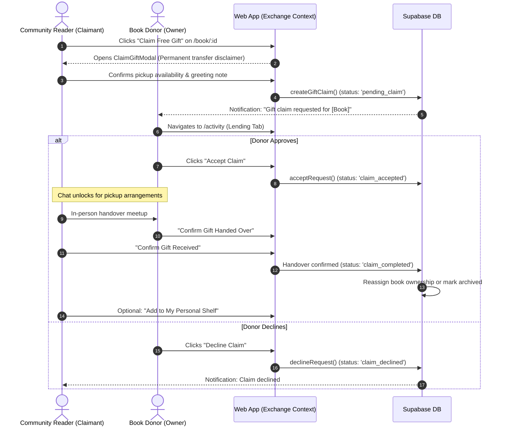
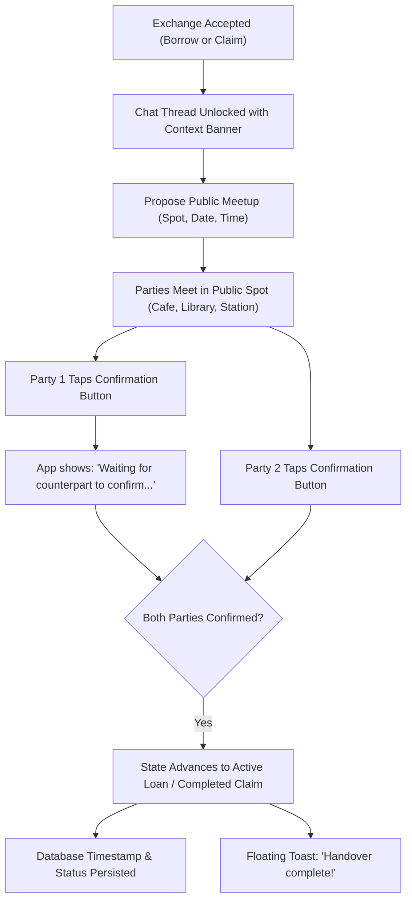
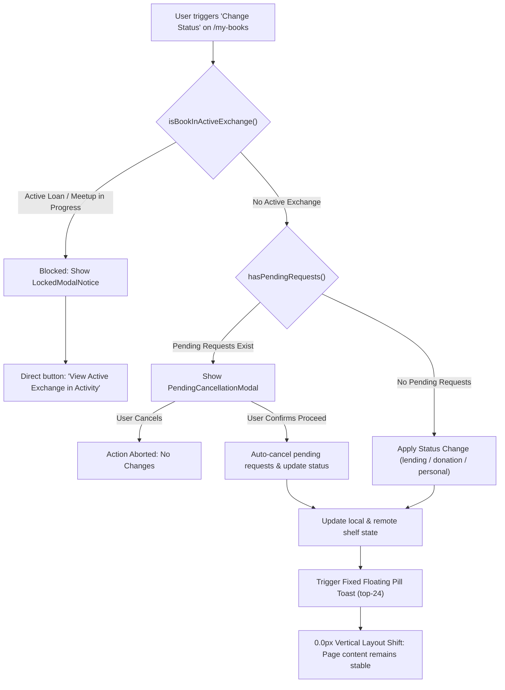

# 🗺️ BookCircle — Complete User Flow Audit & Architecture Guide

> **Official Product Design, UX Architecture & Engineering Reference**  
> **Status:** Audited & Synchronized with Current Implementation  
> **Version:** 2.2.0 (November 2026)  
> **Document Owner:** Product Design, UX Architecture & Frontend Engineering Teams  

---

## 📑 Table of Contents

1. [Executive Summary & Architectural Foundations](#1-executive-summary--architectural-foundations)
2. [User Personas, Roles & Access Control Matrix](#2-user-personas-roles--access-control-matrix)
3. [Core End-to-End System Lifecycles](#3-core-end-to-end-system-lifecycles)
   - [3.1 Borrowing and Lending Lifecycle](#31-borrowing-and-lending-lifecycle)
   - [3.2 Book Donation and Free Claiming Lifecycle](#32-book-donation-and-free-claiming-lifecycle)
   - [3.3 Meetup Scheduling and Dual Confirmation Lifecycle](#33-meetup-scheduling-and-dual-confirmation-lifecycle)
   - [3.4 In-App Messaging & Gated Communication Rules](#34-in-app-messaging--gated-communication-rules)
   - [3.5 Status Updates, Safety Guards & Zero-Layout-Shift Rules](#35-status-updates-safety-guards--zero-layout-shift-rules)
4. [Comprehensive User Flow Inventory](#4-comprehensive-user-flow-inventory)
   - [Domain 1: Authentication & Onboarding (`BC-AUTH`)](#domain-1-authentication--onboarding-bc-auth)
   - [Domain 2: Discovery, Search & Navigation (`BC-DISC`)](#domain-2-discovery-search--navigation-bc-disc)
   - [Domain 3: Book Details, Community Copies & Wishlist (`BC-BOOK`)](#domain-3-book-details-community-copies--wishlist-bc-book)
   - [Domain 4: Author Profiles & Published Works Catalogue (`BC-AUTH-DIR`)](#domain-4-author-profiles--published-works-catalogue-bc-auth-dir)
   - [Domain 5: Borrowing & Lending Transactions (`BC-BORROW`)](#domain-5-borrowing--lending-transactions-bc-borrow)
   - [Domain 6: Book Donation & Free Claiming (`BC-DON`)](#domain-6-book-donation--free-claiming-bc-don)
   - [Domain 7: Shelf & Personal Library Management (`BC-SHELF`)](#domain-7-shelf--personal-library-management-bc-shelf)
   - [Domain 8: Activity Hub & Notifications (`BC-ACT`)](#domain-8-activity-hub--notifications-bc-act)
   - [Domain 9: Real-Time Chat & Floating FAB Coordinator (`BC-MSG`)](#domain-9-real-time-chat--floating-fab-coordinator-bc-msg)
   - [Domain 10: Community Readers & 5-Tier Return Reliability (`BC-RDR`)](#domain-10-community-readers--5-tier-return-reliability-bc-rdr)
   - [Domain 11: Book Reviews & Helpful Upvoting System (`BC-REV`)](#domain-11-book-reviews--helpful-upvoting-system-bc-rev)
   - [Domain 12: Dedicated Settings & User Preferences (`BC-SET`)](#domain-12-dedicated-settings--user-preferences-bc-set)
   - [Domain 13: Community Giving & Platform Support (`BC-COMM`)](#domain-13-community-giving--platform-support-bc-comm)
   - [Domain 14: Catalogue Moderation & Platform Administration (`BC-ADM`)](#domain-14-catalogue-moderation--platform-administration-bc-adm)
5. [Implementation Status & Gap Analysis Matrix](#5-implementation-status--gap-analysis-matrix)
6. [Prioritized Technical & UX Roadmap](#6-prioritized-technical--ux-roadmap)

---

## 1. Executive Summary & Architectural Foundations

BookCircle is a hyperlocal peer-to-peer book lending, donation, and community reading platform. Unlike centralized book delivery services or social cataloguing networks, BookCircle facilitates **in-person, neighborhood-level exchanges** anchored in verified accountability, physical safety, and trust.

### Core Architectural Distinctions:
1. **Canonical Catalogue vs. Community Physical Copies:**  
   Literary works are catalogued centrally by title and author (`CatalogBook` / `CatalogWork`). Members list individual physical copies (`Book`) that possess distinct physical conditions (Like New, Very Good, Good, Fair), owner distances, and availability modes (`lending`, `donation`, `personal`).
2. **Peer Lending vs. Permanent Donation:**  
   - **Lending (`availabilityMode: 'lending'`):** Temporary physical loan (typically 14–30 days) with scheduled return meetup, mutual return condition verification, and points awarded toward the 5-Tier Return Reliability score.
   - **Donation (`availabilityMode: 'donation'`):** Permanent transfer of physical book ownership. No return scheduling exists. Upon handover completion, the book can be permanently adopted into the recipient's personal collection.
   - **Private Collection (`availabilityMode: 'personal'`):** Books tracked by a reader for personal reading logs, excluded from community search, borrow, or claim requests.
3. **Zero-Layout-Shift UX Policy:**  
   All temporary feedback across BookCircle utilizes fixed floating pill toasts (`top-20` / `top-24`, centered, dark frosted slate, emerald accents) rather than in-page alert banners. This guarantees strict `0.0px` vertical displacement of interactive page elements.
4. **Defensive Concurrency Guards:**  
   A book cannot have its status updated to `personal` or be deleted while participating in an active loan or claim. Pending requests are gracefully intercepted, presenting the owner with a cancellation confirmation dialogue.

---

## 2. User Personas, Roles & Access Control Matrix

| Role / Persona | Description | Permitted Actions | Restricted Actions |
| :--- | :--- | :--- | :--- |
| **Guest (`guest`)** | Unauthenticated neighborhood visitor browsing platform. | Search catalog, filter radius, view book details, inspect community copies, read reviews, explore author bibliographies, view public reader profiles. | Submitting borrow/claim requests, messaging, wishlisting, adding books to library, upvoting reviews, modifying settings. Wrapped in `requireAuth()` gate. |
| **Community Reader (`user:borrower`)** | Authenticated resident seeking books nearby. | Submitting borrow requests, claiming free gifts, scheduling meetups, confirming physical handovers, scheduling returns, rating lenders, upvoting reviews. | Cannot edit other members' copies, cannot approve/decline incoming borrow requests on unowned books. |
| **Book Owner (`user:lender`)** | Authenticated resident sharing physical books from their shelf. | Adding books, setting availability mode, approving/declining borrow requests, dual pickup sign-off, inspecting return condition, rating borrowers. | Cannot change status of books locked in active exchanges (`isBookInActiveExchange`). |
| **Author / Literary Creator (`author`)** | Creator of published literary works. | Authors currently exist as canonical directory entities. (Self-claimed verified author accounts are architected for future phases). | Author accounts cannot modify community physical copy listings. |
| **Platform Administrator (`admin`)** | Community safety, catalogue curation, and dispute moderator. | Moderating disputed handovers, curating canonical titles, banning abusive accounts. *(Identified Gap — Future implementation)* | N/A |

---

## 3. Core End-to-End System Lifecycles

### 3.1 Borrowing and Lending Lifecycle

```mermaid
stateDiagram-v2
    [*] --> pending_approval: Borrower submits 3-step Borrow Wizard
    
    pending_approval --> declined: Owner declines request
    declined --> [*]
    
    pending_approval --> cancelled: Borrower cancels pending request
    cancelled --> [*]
    
    pending_approval --> accepted: Owner approves request (In-App Chat unlocks)
    
    accepted --> handover_in_progress: Meetup arrived; waiting for physical handover
    
    handover_in_progress --> active_loan: Dual confirmation (Both confirm pickup)
    handover_in_progress --> disputed_handover: Issue reported at meetup (No-show/condition mismatch)
    
    active_loan --> return_scheduled: Borrower proposes return meetup (date/spot)
    
    return_scheduled --> return_in_progress: Borrower confirms book handed back
    
    return_in_progress --> completed: Owner verifies condition & confirms receipt
    return_in_progress --> disputed_handover: Condition damaged or owner dispute
    
    completed --> rated: Mutual 5-star & punctuality rating submitted
    rated --> [*]: Reliability points credited to 5-Tier Score
```

#### Detailed Borrowing Step-by-Step State Changes:
1. **Discovery:** Borrower browses `/books` or `/book/:id`, selects a copy marked `For Lending`.
2. **Request Submission:** Borrower completes `BorrowWizardModal` (Duration: 14/21/30 days, meetup preference, introductory message). System inserts row into `borrow_requests` with `status: 'pending_approval'`.
3. **Owner Decision:** Owner receives notification bell alert and sees action card in `/activity` (Lending tab).
   - If Owner **Declines**, status moves to `declined`, borrower is notified via toast/notification.
   - If Owner **Approves**, status moves to `accepted`. In-app messaging unlocks for this pair.
4. **Meetup Coordination:** Parties coordinate precise public venue (e.g. Camden Coffee Roasters) via floating chat or `/messages`.
5. **Dual Pickup Confirmation:** At physical meetup:
   - Lender clicks "Confirm Book Handed Over" (`lender_confirmed: true`).
   - Borrower clicks "Confirm Book Received" (`borrower_confirmed: true`).
   - Once both confirm, status updates to `active_loan`, `handover_date` is stamped, and `dueDate` is set (e.g. +30 days). The book's copy status in the library becomes `lent_out`.
6. **Return Scheduling:** When loan period matures or borrower finishes reading, borrower opens `/activity` and clicks "Schedule Return", inputting return date, time, and public spot. Status transitions to `return_scheduled`.
7. **Return Handover:**
   - Borrower hands physical book to lender and taps "Confirm Handed Back". Status moves to `return_in_progress`.
   - Lender inspects book physical condition (Like New, Good, Minor Wear, Damaged) and taps "Confirm Book Received Back".
   - Status updates to `completed`.
8. **Reciprocal Rating:** Both parties submit punctuality and condition feedback. On-time returns credit points toward the borrower's **5-Tier Return Reliability** score.

---

### 3.2 Book Donation and Free Claiming Lifecycle

#### Core Differences Between Borrowing & Donation:
- **No Due Dates:** No calendar calculation, loan countdown, or return deadlines are generated.
- **Permanent Transfer:** The recipient assumes ownership of the physical copy upon completion.
- **Shelf Ledger Integration:** The recipient is provided a 1-click option to adopt the book into their own library (`/my-books`) under `personal` or `lending` mode.

---

### 3.3 Meetup Scheduling and Dual Confirmation Lifecycle

---

### 3.4 In-App Messaging & Gated Communication Rules

To protect neighborhood safety and eliminate spam, unsolicited cold direct messages are prohibited:
1. **Request-Gated Messaging:** A direct chat conversation is automatically unlocked when a book owner **accepts** a borrow or donation claim request.
2. **Contextual Discussion Banner:** Every chat thread displays a sticky header displaying the book thumbnail, title, author, and participant role ("Lending" vs. "Borrowing").
3. **Draft Persistence:** Unsent messages are stored in `localStorage` under `bookcircle_chat_drafts` to ensure zero message loss during page navigation.
4. **Desktop Floating Widget vs. Full Inbox:**
   - Viewport $\ge 640\text{px}$: Floating widget at bottom-right with 3-state animation (`expanded`, `minimized`, `closed`).
   - Viewport $< 640\text{px}$: Slide-up responsive bottom sheet or dedicated `/messages` route.

---

### 3.5 Status Updates, Safety Guards & Zero-Layout-Shift Rules

---

## 4. Comprehensive User Flow Inventory

### Domain 1: Authentication & Onboarding (`BC-AUTH`)

#### `BC-AUTH-01`: Guest Browsing & Privileged Action Gate
- **Flow ID:** `BC-AUTH-01`
- **Flow Name:** Guest Browsing & Privileged Action Gate
- **User Role:** Guest (Unauthenticated Visitor)
- **Entry Point:** Any public route (`/`, `/books`, `/book/:bookId`, `/author/:authorId`, `/readers`, `/reader/:readerId`)
- **Preconditions:** User has no active session in `AuthContext` (`currentUser == null`).
- **Main Flow:**
  1. Visitor explores public books, filters by radius or genre, views author profiles, or reads reviews.
  2. Visitor attempts a privileged action: clicks "Request to Borrow", "Claim Free Gift", "+ Add Book", "Message Reader", "Upvote Review", or "Wishlist".
  3. `requireAuth()` intercepts the action, caches the intended action/payload, and mounts `AuthModal`.
  4. Visitor completes authentication (Google, WhatsApp, or Demo).
  5. Upon successful sign-in, `AuthModal` dismisses and the intercepted action resumes automatically.
- **Decision Points & Branches:**
  - *Option A:* User signs in $\rightarrow$ Proceeds with queued action.
  - *Option B:* User dismisses modal $\rightarrow$ Remains on current page as guest; no state is mutated.
- **Alternative Flows:** If user chooses "Create Account" tab, proceeds to register with email/password.
- **Error & Empty States:** Network failure shows inline error banner inside `AuthModal`.
- **Completion State:** Authenticated session active in `localStorage` and `AuthContext`; user returns to previous interaction context.
- **Related Pages & Components:** `src/components/auth/AuthModal.tsx`, `src/context/AuthContext.tsx`, `src/App.tsx`.

---

#### `BC-AUTH-02`: Social Authentication (Google OAuth)
- **Flow ID:** `BC-AUTH-02`
- **Flow Name:** Social Authentication via Google
- **User Role:** Any User
- **Entry Point:** `AuthModal` $\rightarrow$ "Continue with Google" button.
- **Preconditions:** Google Client ID configured in Supabase.
- **Main Flow:**
  1. User clicks "Continue with Google".
  2. OAuth redirect/popup opens Google account selector.
  3. User consents to profile and email permissions.
  4. Supabase validates token, updates or creates row in `profiles` table.
  5. Session initializes in `AuthContext`, modal closes, user receives welcome toast.
- **Decision Points & Branches:** If user profile lacks neighborhood location, redirects to `ProfileSetupModal`.
- **Alternative Flows:** Cancelled OAuth returns user to `AuthModal` with informative notice.
- **Error & Empty States:** Popup blocked or connection failure displays error in modal.
- **Completion State:** User authenticated, avatar and display name populated from Google account.
- **Related Pages & Components:** `src/components/auth/AuthModal.tsx`, `src/services/authService.ts`.

---

#### `BC-AUTH-03`: WhatsApp / Phone OTP Authentication
- **Flow ID:** `BC-AUTH-03`
- **Flow Name:** WhatsApp / Phone OTP Authentication
- **User Role:** Any User
- **Entry Point:** `AuthModal` $\rightarrow$ "Continue with WhatsApp / Phone".
- **Preconditions:** Valid phone number input.
- **Main Flow:**
  1. User enters phone number with country code.
  2. System triggers `sendOtp()` via Supabase Auth.
  3. Modal displays 6-digit numeric input field with countdown timer for resend.
  4. User inputs 6-digit code received via SMS/WhatsApp.
  5. System validates OTP; session token is stored.
- **Decision Points & Branches:**
  - *Code Valid:* Completes auth and launches onboarding if first login.
  - *Code Invalid:* Highlights inputs in red with "Invalid verification code. Try again."
- **Alternative Flows:** User clicks "Resend Code" after 60s timeout expires.
- **Error & Empty States:** Rate limiting displays alert: "Too many attempts. Please wait 5 minutes."
- **Completion State:** Session saved in `localStorage`, user redirected to requested page.
- **Related Pages & Components:** `src/components/auth/AuthModal.tsx`.

---

#### `BC-AUTH-04`: New User Onboarding & Location Setup
- **Flow ID:** `BC-AUTH-04`
- **Flow Name:** First-Time Onboarding & Location Setup
- **User Role:** Newly Registered User
- **Entry Point:** Automatically mounts following registration if `isProfileComplete == false`.
- **Preconditions:** Authenticated account created without saved neighborhood.
- **Main Flow:**
  1. `WelcomeOnboardingModal` displays 3-slide visual carousel:
     - Slide 1: Hyperlocal Book Sharing (Borrow books within walking distance).
     - Slide 2: Safe Public Meetups (Exchange at neighborhood cafes and libraries).
     - Slide 3: 5-Tier Return Reliability (Earn trust points for on-time returns).
  2. User clicks "Set Up Profile" transitioning to `ProfileSetupModal`.
  3. User inputs neighborhood name (e.g. "Elm Park, North London"), selects default search radius (1km, 2km, 5km, 10km), and uploads avatar.
  4. User clicks "Complete Setup".
  5. Onboarding flag `bookcircle_onboarding_dismissed` written to `localStorage`.
- **Decision Points & Branches:** User can click "Skip for now", assigning default 5km radius and "Local Neighbor" placeholder.
- **Alternative Flows:** User can update neighborhood anytime later in `/settings` or `/profile`.
- **Error & Empty States:** Empty neighborhood input disables submit button.
- **Completion State:** Profile persisted to database, user lands on `/books` with books filtered to their radius.
- **Related Pages & Components:** `src/components/onboarding/WelcomeOnboardingModal.tsx`, `src/components/auth/ProfileSetupModal.tsx`.

---

#### `BC-AUTH-05`: Demo Account Quick Sign-In
- **Flow ID:** `BC-AUTH-05`
- **Flow Name:** Demo Account Quick Sign-In
- **User Role:** Evaluator / Reviewer / Developer
- **Entry Point:** `AuthModal` bottom section $\rightarrow$ "Quick Demo Sign-In".
- **Preconditions:** None.
- **Main Flow:**
  1. User selects "Sign in as Maya Lin (Lender & Borrower)" or "Sign in as Alex Rivera (Community Reader)".
  2. System synthesizes complete demo user object with verified trust badge, sample library, active exchanges, and chat messages.
  3. Session is injected into `AuthContext` and `localStorage`.
  4. Modal dismisses; floating toast announces: "Signed in as Maya Lin (Demo)".
- **Decision Points & Branches:** Allows instant toggling between Lender and Borrower perspectives.
- **Alternative Flows:** None.
- **Error & Empty States:** N/A (Client-side mock session fallback).
- **Completion State:** Authenticated user session active with full mock state.
- **Related Pages & Components:** `src/components/auth/AuthModal.tsx`, `src/context/AuthContext.tsx`.

---

#### `BC-AUTH-06`: Sign Out & Session Teardown
- **Flow ID:** `BC-AUTH-06`
- **Flow Name:** Sign Out & Session Teardown
- **User Role:** Authenticated User
- **Entry Point:** Navbar user dropdown $\rightarrow$ "Sign Out".
- **Preconditions:** Active session exists.
- **Main Flow:**
  1. User clicks "Sign Out" from navbar avatar dropdown.
  2. `LogoutConfirmDialog` appears: "Are you sure you want to sign out?"
  3. User confirms sign-out.
  4. `authService.signOut()` clears tokens from `localStorage`, resets `AuthContext`, and closes active floating chat widgets.
  5. User is redirected to `/` (Home) in guest mode.
- **Decision Points & Branches:** User clicks "Cancel" in dialog $\rightarrow$ Dialog closes with no session mutation.
- **Alternative Flows:** None.
- **Error & Empty States:** Network error still forces local storage clearance to ensure secure client logout.
- **Completion State:** User is unauthenticated guest at homepage.
- **Related Pages & Components:** `src/components/LogoutConfirmDialog.tsx`, `src/components/Navbar.tsx`.

---

### Domain 2: Discovery, Search & Navigation (`BC-DISC`)

#### `BC-DISC-01`: Homepage Exploration & Category Browsing
- **Flow ID:** `BC-DISC-01`
- **Flow Name:** Homepage Exploration & Category Browsing
- **User Role:** Any User
- **Entry Point:** Navigation to `/`.
- **Preconditions:** None.
- **Main Flow:**
  1. User arrives on homepage, viewing hero banner and quick search input.
  2. User browses category pill bar (`CategoryPills`: All, Fiction, Non-fiction, Science, History, Poetry).
  3. User clicks a category (e.g. "Fiction"); the books grid filters reactively.
  4. User scrolls to "Readers Near You" section to view active neighbors.
- **Decision Points & Branches:**
  - Clicking a book card $\rightarrow$ Navigates to `/book/:bookId`.
  - Clicking "View All Books" $\rightarrow$ Navigates to `/books`.
  - Clicking an author name $\rightarrow$ Navigates to `/author/:authorId`.
- **Alternative Flows:** Empty category displays empty shelf notice with link to reset filters.
- **Error & Empty States:** If backend fails to load books, fallback mock dataset renders automatically.
- **Completion State:** User discovers desired book or author.
- **Related Pages & Components:** `src/App.tsx`, `src/components/BooksSection.tsx`, `src/components/CategoryPills.tsx`.

---

#### `BC-DISC-02`: Hyperlocal Search & Neighborhood Radius Filtering
- **Flow ID:** `BC-DISC-02`
- **Flow Name:** Hyperlocal Search & Neighborhood Radius Filtering
- **User Role:** Any User
- **Entry Point:** `/books` (Find & Explore Books).
- **Preconditions:** None.
- **Main Flow:**
  1. User navigates to `/books`.
  2. User enters text into search input (matches title, author, description, or category).
  3. User adjusts the Proximity Radius selector ("Within 1 km", "Within 2 km", "Within 5 km", "Within 10 km", "All Distances").
  4. Books list reactively recalculates and updates the count header ("Showing 12 books near you").
- **Decision Points & Branches:**
  - Changing radius filters out copies beyond the specified distance.
  - Clearing search input restores full radius results.
- **Alternative Flows:** If 0 books match, empty state card displays: "No books found within [X] km. Try expanding your radius." with a 1-click button to expand to 10 km.
- **Error & Empty States:** Empty search state includes a "Reset All Filters" button.
- **Completion State:** User views filtered list of available books in immediate physical proximity.
- **Related Pages & Components:** `src/components/books/BooksBrowsePage.tsx`.

---

#### `BC-DISC-03`: Availability Mode Filtering (All vs. To Lend vs. Free Gift)
- **Flow ID:** `BC-DISC-03`
- **Flow Name:** Availability Mode Filtering
- **User Role:** Any User
- **Entry Point:** `/books` toolbar $\rightarrow$ Mode Tabs.
- **Preconditions:** None.
- **Main Flow:**
  1. User views availability mode filter tabs:
     - **All Copies:** Displays both lending loans and free gifts.
     - **🤝 To Lend:** Displays only books requiring return (temporary peer borrowing).
     - **🎁 Free Gift:** Displays only books marked for permanent community donation.
  2. User clicks "🎁 Free Gift".
  3. Catalogue filters exclusively to donation copies with distinctive green badges and "Claim Free Gift" quick actions.
- **Decision Points & Branches:** User can combine Mode Filtering with Radius Filtering and Category Pills.
- **Alternative Flows:** Switching to "To Lend" displays amber badges with "Request to Borrow" triggers.
- **Error & Empty States:** If no free gifts exist in radius, displays prompt: "No free community gifts listed nearby today. Check back soon or browse books available to borrow."
- **Completion State:** Results restricted to desired exchange model.
- **Related Pages & Components:** `src/components/books/BooksBrowsePage.tsx`, `src/components/BookCard.tsx`.

---

#### `BC-DISC-04`: Grid View vs. Compact List View Toggle
- **Flow ID:** `BC-DISC-04`
- **Flow Name:** Grid View vs. Compact List View Toggle
- **User Role:** Any User
- **Entry Point:** `/books` toolbar $\rightarrow$ View Toggle icons.
- **Preconditions:** None.
- **Main Flow:**
  1. User on `/books` clicks the view toggle switch in the toolbar.
  2. Selecting **Grid View** renders 4-column responsive cards with cover art dominance, condition badges, and owner avatars.
  3. Selecting **Compact List View** renders horizontal rows displaying thumbnail, title, author, distance, owner, rating, and action buttons on a single row.
  4. User preference is preserved during current browsing session.
- **Decision Points & Branches:** Mobile viewports automatically adapt list view to high-density single-column format.
- **Alternative Flows:** None.
- **Error & Empty States:** N/A.
- **Completion State:** Desired presentation density applied across all search results.
- **Related Pages & Components:** `src/components/books/BooksBrowsePage.tsx`.

---

### Domain 3: Book Details, Community Copies & Wishlist (`BC-BOOK`)

#### `BC-BOOK-01`: Book Details Exploration & Multi-Copy Inspection
- **Flow ID:** `BC-BOOK-01`
- **Flow Name:** Book Details Exploration & Multi-Copy Inspection
- **User Role:** Any User
- **Entry Point:** Clicking any book card across Home, Explore, Author, or Reader pages.
- **Preconditions:** Book ID or slug exists.
- **Main Flow:**
  1. User lands on `/book/:bookId`.
  2. Hero section displays canonical book cover, title, author link, publication year, average rating, total reviews count, and synopsis with "Read More / Read Less" toggle.
  3. User scrolls down to "Community Copies in Your Area" section.
  4. System renders distinct cards for every neighbor owning a physical copy:
     - Owner profile photo, name, neighborhood, and exact distance.
     - Copy condition badge ("Like New", "Very Good", "Good", "Fair").
     - Loan mode badge ("🤝 For Lending" or "🎁 For Donation").
     - Direct action button: "Request to Borrow" or "Claim Free Gift".
  5. User scrolls to "Community Reviews" preview showing average score, 5-star distribution bars, top 3 reviews, and "View All Reviews" link.
- **Decision Points & Branches:**
  - Clicking Owner Name/Avatar $\rightarrow$ Navigates to `/reader/:readerId`.
  - Clicking Author Name $\rightarrow$ Navigates to `/author/:authorId`.
  - Clicking "View All Reviews" $\rightarrow$ Navigates to `/book/:bookId/reviews`.
  - Clicking "Write a Review" $\rightarrow$ Opens `ReviewModal`.
- **Alternative Flows:** If all copies are currently `lent_out`, primary button changes to "Join Waitlist / Wishlist".
- **Error & Empty States:** Invalid book ID redirects to `NotFoundPage` with return home link.
- **Completion State:** User selects specific physical copy to initiate exchange.
- **Related Pages & Components:** `src/components/bookdetails/BookDetailsPage.tsx`, `src/components/bookdetails/ReviewModal.tsx`.

---

#### `BC-BOOK-02`: Zero Community Copies Exploration & Community Sourcing
- **Flow ID:** `BC-BOOK-02`
- **Flow Name:** Zero Community Copies Exploration & Sourcing
- **User Role:** Any User
- **Entry Point:** Navigating to a published canonical book with no currently listed community copies (e.g. from an Author Profile bibliography).
- **Preconditions:** Book exists in `canonicalCatalog` (`CatalogBook`), but `communityCopies.length === 0`.
- **Main Flow:**
  1. User arrives on `/book/:canonicalId`.
  2. Hero displays full canonical metadata (title, author, cover, synopsis, ratings).
  3. Primary CTA displays "Add to Wishlist & Get Notified".
  4. The "Community Copies" section renders an empty shelf illustration with a message:
     *"No physical copies currently available in your neighborhood."*
     *"Do you own this book? Be the first neighbor to share it with the community!"*
  5. User clicks "+ Add This Book to Community".
  6. `AddBookModal` opens with Title, Author, Category, and Cover pre-populated from canonical catalog data.
- **Decision Points & Branches:**
  - User submits `AddBookModal` $\rightarrow$ Copy immediately added to their shelf and page refreshes showing 1 available copy.
  - User clicks Wishlist $\rightarrow$ Added to wishlist; notified when any neighbor lists a copy.
- **Alternative Flows:** Unauthenticated user clicking "+ Add This Book" is guided through `requireAuth()`.
- **Error & Empty States:** Empty copy listing handled with clear, actionable community call-to-action.
- **Completion State:** User either requests alert or adds their own copy to the platform.
- **Related Pages & Components:** `src/components/bookdetails/BookDetailsPage.tsx`, `src/components/mybooks/AddBookModal.tsx`.

---

#### `BC-BOOK-03`: Wishlist Management & Return Notification Alert
- **Flow ID:** `BC-BOOK-03`
- **Flow Name:** Wishlist Management & Return Notification Alert
- **User Role:** Authenticated User (or Guest guided via auth)
- **Entry Point:** Heart icon button on `/book/:bookId` or book card.
- **Preconditions:** Book selected.
- **Main Flow:**
  1. User clicks Heart button on `/book/:bookId`.
  2. If unauthenticated, `requireAuth()` prompts login; resumes action upon authentication.
  3. System calls `toggleWishlist(book.id)`.
  4. If added:
     - Heart icon fills red with subtle bounce animation.
     - Book's wishlist counter increments by 1.
     - Fixed dark floating pill toast appears at `top-20` / `top-24`:
       - If book is available: `❤️ Saved to your Wishlist!`
       - If book is currently lent out: `🔔 Added to Wishlist! We will notify you the moment this book is returned.`
  5. If removed:
     - Heart resets to outline.
     - Wishlist counter decrements.
     - Fixed dark floating pill toast appears: `Removed from your Wishlist.`
- **Decision Points & Branches:** Clicking heart again toggles state.
- **Alternative Flows:** When a lent-out book on a user's wishlist is returned by its borrower, system generates a notification: `"[Book Title] is now back on the shelf and available to borrow!"`
- **Error & Empty States:** Layout shift is strictly 0.0px; toast auto-dismisses after 3500ms.
- **Completion State:** Wishlist updated in database and local user state.
- **Related Pages & Components:** `src/components/bookdetails/BookDetailsPage.tsx`, `src/context/AuthContext.tsx`.

---

#### `BC-BOOK-04`: Wishlist Drawer / Modal Management & Filtering
- **Flow ID:** `BC-BOOK-04`
- **Flow Name:** Wishlist Drawer / Modal Management
- **User Role:** Authenticated User
- **Entry Point:** Navbar user dropdown $\rightarrow$ "My Wishlist", or Profile Page $\rightarrow$ "Wishlist" tab.
- **Preconditions:** User has active session.
- **Main Flow:**
  1. User opens `WishlistModal`.
  2. Modal displays all saved titles with cover, author, availability status, and owner distance.
  3. Filter tabs allow filtering between:
     - **All Wishlist**
     - **Available Now** (copies ready for immediate borrowing)
     - **Currently On Loan** (copies awaiting return)
  4. For available books, user can click "Request to Borrow" directly from the wishlist modal.
  5. User can click the Trash icon to remove any title from their wishlist.
- **Decision Points & Branches:** Clicking a book row closes modal and navigates to `/book/:bookId`.
- **Alternative Flows:** Empty wishlist displays: *"Your wishlist is empty. Tap the heart on any book to track availability."* with a button to "Explore Books".
- **Error & Empty States:** Graceful empty state with call-to-action.
- **Completion State:** Wishlist items inspected, borrowed, or pruned.
- **Related Pages & Components:** `src/components/profile/WishlistModal.tsx`.

---

### Domain 4: Author Profiles & Published Works Catalogue (`BC-AUTH-DIR`)

#### `BC-AUTH-DIR-01`: Dedicated Author Profile & Bibliography Exploration
- **Flow ID:** `BC-AUTH-DIR-01`
- **Flow Name:** Dedicated Author Profile & Bibliography Exploration
- **User Role:** Any User
- **Entry Point:** Clicking author name on any book card, details page, or catalogue card.
- **Preconditions:** Author ID / slug exists.
- **Main Flow:**
  1. User lands on `/author/:authorId`.
  2. Author Header Card displays:
     - Author photo or elegant fallback monogram with nationality badge.
     - Full name, nationality flag, birth/death years or active era.
     - Comprehensive biographical summary and notable awards/honors.
     - Statistical counters: Total Published Works, Community Copies in Circulation.
     - Action buttons: "+ Follow Author" and "Share Profile".
  3. User scrolls to "Published Books" section featuring dedicated in-author search and genre chips.
  4. System renders one unique catalogue card (`BookCatalogueCard`) per published work, preventing redundant duplicates of identical titles.
- **Decision Points & Branches:**
  - Clicking "Follow Author" toggles follow state and triggers floating confirmation toast.
  - Clicking "Share Profile" copies canonical URL to clipboard with confirmation toast.
  - Using search filters bibliography in real time.
- **Alternative Flows:** If an author has 0 community copies in circulation, bibliography still displays all published works with prompt to add copies.
- **Error & Empty States:** Unrecognized author slug falls back to synthesized author record using name.
- **Completion State:** User discovers complete published bibliography of their favorite creator.
- **Related Pages & Components:** `src/components/author/AuthorProfilePage.tsx`, `src/data/authors.ts`.

---

#### `BC-AUTH-DIR-02`: Unique Catalogue Card Copy Clustered Navigation
- **Flow ID:** `BC-AUTH-DIR-02`
- **Flow Name:** Unique Catalogue Card Clustered Navigation
- **User Role:** Any User
- **Entry Point:** `/author/:authorId` $\rightarrow$ Published Books list.
- **Preconditions:** Author bibliography rendered.
- **Main Flow:**
  1. User inspects `BookCatalogueCard`.
  2. Card presents:
     - Book cover image, title, publication year, average rating, and review count.
     - **Single-Line Copy Count Row (No wrapping):**
       - If community copies exist: `2 copies` on the left, `2 available` on the right.
       - If no community copies exist: `0 Community copies` on the left (no availability text).
     - Compact vertical layout without excessive padding.
  3. User clicks the primary button: **"Explore Copies"**.
  4. System navigates to `/book/:canonicalId`.
  5. If copies exist, page displays all neighbor physical copies.
  6. If 0 copies exist, page displays the zero-copies community sourcing prompt.
- **Decision Points & Branches:** User directly accesses all community inventory for a title from one unified card.
- **Alternative Flows:** None.
- **Error & Empty States:** Handles 0 copies gracefully without layout distortion.
- **Completion State:** User arrives at `/book/:bookId` to choose a specific neighbor copy.
- **Related Pages & Components:** `src/components/author/BookCatalogueCard.tsx`, `src/components/bookdetails/BookDetailsPage.tsx`.

---

#### `BC-AUTH-DIR-03`: Author Following & Profile Link Sharing
- **Flow ID:** `BC-AUTH-DIR-03`
- **Flow Name:** Author Following & Profile Link Sharing
- **User Role:** Authenticated User (Guest guided via auth)
- **Entry Point:** Header buttons on `/author/:authorId`.
- **Preconditions:** Author profile loaded.
- **Main Flow:**
  1. User clicks "+ Follow Author".
  2. If unauthenticated, `requireAuth()` prompts login; action resumes after sign-in.
  3. Button toggles to "Following" with checkmark icon and emerald accent.
  4. Floating toast confirms: `"You are now following [Author Name]. We'll notify you when new copies are listed."`
  5. User clicks "Share Profile".
  6. Web Share API or Clipboard API copies URL (`window.location.href`).
  7. Floating toast confirms: `"Author profile link copied to clipboard!"`
- **Decision Points & Branches:** Clicking "Following" prompts unfollow option.
- **Alternative Flows:** Browser clipboard permission rejection falls back to manual modal with copy button.
- **Error & Empty States:** Floating toast informs user of success or error.
- **Completion State:** Follow state recorded; URL copied to clipboard.
- **Related Pages & Components:** `src/components/author/AuthorProfilePage.tsx`.

---

### Domain 5: Borrowing & Lending Transactions (`BC-BORROW`)

#### `BC-BORROW-01`: Borrow Request Submission (3-Step Wizard)
- **Flow ID:** `BC-BORROW-01`
- **Flow Name:** Borrow Request Submission
- **User Role:** Borrower (Community Reader)
- **Entry Point:** Clicking "Request to Borrow" on any lending book card or details page.
- **Preconditions:** User authenticated; book has `availabilityMode: 'lending'`; book copy is currently available.
- **Main Flow:**
  1. `BorrowWizardModal` opens with 3-step progressive flow:
     - **Step 1 (Loan Duration):** User selects 14 Days, 21 Days, or 30 Days. An interactive calendar preview highlights the proposed return due date.
     - **Step 2 (Meetup Preference):** User selects preferred exchange venue (e.g. "Public Café / Library", "Owner's Porch / Doorstep", "Transit Station") and preferred time window (Morning, Afternoon, Evening).
     - **Step 3 (Pledge & Greeting):** User inputs personal note introducing themselves and acknowledges BookCircle's community care pledge ("I treat shared books with care and return them on time").
  2. User clicks "Send Borrow Request".
  3. `exchangeService.createBorrowRequest()` registers exchange with `status: 'pending_approval'`.
  4. Floating toast confirms: `"Borrow request sent to [Owner Name]!"`
  5. Modal closes; user is guided to `/activity` to track progress.
- **Decision Points & Branches:** User can cancel modal at any step without saving changes.
- **Alternative Flows:** If user is book owner, button is disabled with tooltip: "This is your copy".
- **Error & Empty States:** Network error displays error banner within wizard.
- **Completion State:** Transaction record created; owner receives notification; borrower sees pending card in `/activity`.
- **Related Pages & Components:** `src/components/borrow/BorrowWizardModal.tsx`, `src/services/exchangeService.ts`, `src/context/ExchangeContext.tsx`.

---

#### `BC-BORROW-02`: Owner Request Review & Approval / Decline Decision
- **Flow ID:** `BC-BORROW-02`
- **Flow Name:** Owner Request Review & Approval / Decline
- **User Role:** Book Owner (Lender)
- **Entry Point:** Notification dropdown click or `/activity` $\rightarrow$ "Lending" tab.
- **Preconditions:** An exchange exists with `status: 'pending_approval'`.
- **Main Flow:**
  1. Owner navigates to `/activity` (Lending tab).
  2. Action card displays:
     - Borrower avatar, name, neighborhood distance, and 5-Tier Return Reliability badge.
     - Book cover, title, proposed loan duration, proposed meetup spot, and borrower greeting note.
  3. Owner evaluates request:
     - **To Approve:** Owner clicks "Accept Request". Status transitions to `accepted`. In-app chat unlocks. Floating toast confirms: `"Request accepted! Coordinate meetup with [Borrower]."`
     - **To Decline:** Owner clicks "Decline Request". Confirmation modal asks for optional reason (e.g. "Currently reading this", "Unavailable this week"). Status transitions to `declined`. Borrower is notified.
- **Decision Points & Branches:**
  - *Accept:* Moves exchange to active coordination.
  - *Decline:* Archives exchange, restores copy availability for other neighbors.
- **Alternative Flows:** Borrower can cancel pending request before owner responds (`status: 'cancelled'`).
- **Error & Empty States:** If request was cancelled by borrower in the interim, clicking accept shows: "This request has already been cancelled."
- **Completion State:** Status updated in database; both parties notified.
- **Related Pages & Components:** `src/components/activity/ActivityPage.tsx`, `src/services/exchangeService.ts`.

---

#### `BC-BORROW-03`: In-App Meetup Scheduling & Coordination
- **Flow ID:** `BC-BORROW-03`
- **Flow Name:** In-App Meetup Scheduling & Coordination
- **User Role:** Borrower and Lender
- **Entry Point:** `/activity` $\rightarrow$ "Message Lender / Borrower" or Floating Chat Widget.
- **Preconditions:** Exchange has `status: 'accepted'`.
- **Main Flow:**
  1. Once accepted, chat conversation opens with a sticky top banner: *"Discussing Handover: [Book Title]"*.
  2. Participants exchange direct messages agreeing on exact day, time, and specific location (e.g. "Costa Coffee on High Street, Tuesday at 5:30 PM").
  3. Either party can click "Update Meetup Details" in the chat menu to set the agreed schedule (`meetupDate`, `meetupTime`, `meetupSpot`).
  4. System updates exchange record and displays reminder in `/activity` action header.
- **Decision Points & Branches:** If plans change, either party can send a revised meetup proposal in chat.
- **Alternative Flows:** If participant fails to respond within 48 hours, reminder button appears: "Send Handover Reminder".
- **Error & Empty States:** Disputed meetup details can be flagged to community support.
- **Completion State:** Mutually agreed meetup details saved to exchange record.
- **Related Pages & Components:** `src/components/chat/FloatingChatWidget.tsx`, `src/components/inbox/InboxPage.tsx`.

---

#### `BC-BORROW-04`: Physical Pickup Handover & Dual Confirmation Sign-Off
- **Flow ID:** `BC-BORROW-04`
- **Flow Name:** Physical Pickup Handover & Dual Confirmation
- **User Role:** Borrower and Lender
- **Entry Point:** Physical meetup $\rightarrow$ `/activity` action card.
- **Preconditions:** Exchange status is `accepted` or `handover_in_progress`.
- **Main Flow:**
  1. Both parties meet at agreed public location.
  2. Lender hands physical book to Borrower. Borrower inspects condition (agrees with listed condition).
  3. **Lender Confirmation:** Lender clicks "Confirm Book Handed Over". `lender_confirmed` is set to `true`.
  4. **Borrower Confirmation:** Borrower clicks "Confirm Book Received". `borrower_confirmed` is set to `true`.
  5. Once **both** parties confirm:
     - Exchange status transitions to `active_loan`.
     - `handover_date` timestamp is recorded.
     - `dueDate` is calculated (e.g. current date + 30 days).
     - Physical book copy status in database transitions to `lent_out`.
     - Floating toast announces: `"Handover confirmed! Enjoy reading [Book Title]."`
- **Decision Points & Branches:** If only one party has confirmed, the other party's card displays: *"Waiting for [Name] to confirm handover..."*
- **Alternative Flows:** If book condition is significantly worse than advertised or party fails to appear, user clicks "Report Issue" (`status: 'disputed_handover'`).
- **Error & Empty States:** If connection drops, offline confirmation syncs on reconnection.
- **Completion State:** Book is officially on active loan; countdown timer begins.
- **Related Pages & Components:** `src/components/activity/ActivityPage.tsx`, `src/services/exchangeService.ts`.

---

#### `BC-BORROW-05`: Active Loan Tracking & Return Schedule Wizard
- **Flow ID:** `BC-BORROW-05`
- **Flow Name:** Active Loan Tracking & Return Schedule Wizard
- **User Role:** Borrower
- **Entry Point:** `/activity` $\rightarrow$ "Borrowing" tab $\rightarrow$ Active Loan Card.
- **Preconditions:** Exchange has `status: 'active_loan'`.
- **Main Flow:**
  1. Borrower views active loan card displaying days remaining (e.g. "12 days left"), due date, and lender contact.
  2. When ready to return, Borrower clicks **"Schedule Return"**.
  3. `ReturnWizardModal` opens:
     - **Step 1:** Select proposed return date and time window.
     - **Step 2:** Select return meetup spot (e.g. same cafe or convenient neighborhood location).
     - **Step 3:** Add optional return note to lender.
  4. Borrower clicks "Submit Return Schedule".
  5. Status transitions to `return_scheduled`. Tracking code generated.
  6. Lender is alerted via notification dropdown and activity card.
- **Decision Points & Branches:** Borrower can propose renewal if book has no pending waitlist reservations.
- **Alternative Flows:** If loan becomes overdue, card changes to red alert: "Return Overdue by X days. Please coordinate with lender immediately."
- **Error & Empty States:** Missing return date disables submission.
- **Completion State:** Return appointment confirmed between parties.
- **Related Pages & Components:** `src/components/borrow/ReturnWizardModal.tsx`, `src/components/activity/ActivityPage.tsx`.

---

#### `BC-BORROW-06`: Book Return Receipt, Condition Inspection & Independent Post-Return Feedback
- **Flow ID:** `BC-BORROW-06`
- **Flow Name:** Book Return Receipt, Condition Inspection & Independent Post-Return Feedback
- **User Role:** Borrower and Lender
- **Entry Point:** Physical return meetup $\rightarrow$ `/activity`.
- **Preconditions:** Exchange status is `return_scheduled` or `return_in_progress` (or active loan via Direct Return).
- **Main Flow:**
  1. **Borrower Handover:**
     - Borrower meets Lender at return location.
     - Borrower clicks **"I Handed Back the Book"**.
     - Status moves to `return_in_progress` (waiting for receipt confirmation; loan is NOT completed yet).
     - Borrower sees confirmation message: *"You've handed back the book. Waiting for the lender to confirm receipt."*
  2. **Lender Inspection & Confirmation (`InspectReturnModal`):**
     - Lender navigates to Activity $\rightarrow$ Lending $\rightarrow$ "Returns to Review".
     - Lender clicks **"Inspect & Confirm Receipt"**.
     - Dedicated inspection modal opens, displaying:
       - Book details, borrower profile, and meetup context.
       - **Original Condition recorded when borrowed** (e.g., Like New, Good).
       - Returned condition selector: *Like New*, *Good*, *Minor Wear*, *Damaged*.
       - Optional notes / feedback.
     - Lender clicks **"Confirm Receipt & Close Loan"**.
     - Transaction transitions to `completed`, borrowing history updates, and book availability reverts to `available` (or `donation`).
  3. **Alternative Direct Return Flow (`RecordDirectReturnModal`):**
     - When parties return a book outside the scheduled wizard, Lender clicks **"Record Direct Return"** on Active Loans.
     - Confirmation modal displays handover notice, baseline original condition, returned condition selector, and a mandatory confirmation checkbox: *"I confirm that I have physically received this book back from [Borrower]"*.
     - Button **"Confirm Direct Return & Close Loan"** is enabled only upon explicit confirmation.
  4. **Independent Post-Return Feedback 1: Borrower $\rightarrow$ Book Review:**
     - Prompt banner displayed to Borrower: *"How was your reading experience? You've finished reading this book! Share your thoughts to help other readers discover their next favourite book."*
     - Actions: **Write a Review** & **Skip for Now**.
     - Opens existing `ReviewModal`; automatically links review to book catalog. Allows star rating and written review.
     - If already reviewed, presents option to update review without duplicate submissions.
  5. **Independent Post-Return Feedback 2: Lender $\rightarrow$ Reader Feedback (`RateReaderModal`):**
     - Prompt banner displayed to Lender: *"How was your experience with this reader? Share your experience to help build a trustworthy book-sharing community."*
     - Actions: **Rate Reader** & **Skip for Now**.
     - Evaluates 3 criteria: Return Punctuality (*On Time*, *Slight Delay*, *Late*), Book Care (*Excellent Care*, *Minor Wear*, *Damaged*), and Overall Borrowing Experience (1–5 stars), plus optional comment.
     - Associated with completed transaction and borrower; updates trust and community reliability without altering the book's star rating.
  6. **Revisit Access in Activity History:**
     - Both feedback opportunities are optional and independent.
     - If skipped, users can complete them later in **Activity $\rightarrow$ History**:
       - Borrower sees **"Write Book Review"** (or **"✓ Book Reviewed"**).
       - Lender sees **"Rate Reader"** (or **"✓ Reader Rated"**).
- **Decision Points & Branches:** If condition damaged, logged into audit history; optional direct messaging link provided.
- **Completion State:** Book back in library, loan completed, independent reading and community feedback recorded.
- **Related Pages & Components:** `src/components/activity/ActivityPage.tsx`, `src/components/activity/InspectReturnModal.tsx`, `src/components/activity/RecordDirectReturnModal.tsx`, `src/components/activity/RateReaderModal.tsx`, `src/components/bookdetails/ReviewModal.tsx`, `src/services/exchangeService.ts`, `src/services/reviewService.ts`.

---

### Domain 6: Book Donation & Free Claiming (`BC-DON`)

#### `BC-DON-01`: Free Community Gift Claim Submission (2-Step Claim Wizard)
- **Flow ID:** `BC-DON-01`
- **Flow Name:** Free Community Gift Claim Submission
- **User Role:** Recipient (Community Reader)
- **Entry Point:** Clicking "Claim Free Gift" on any donation book card or details page.
- **Preconditions:** User authenticated; book has `availabilityMode: 'donation'`; copy is available.
- **Main Flow:**
  1. `ClaimGiftModal` opens with 2-step flow:
     - **Step 1 (Permanent Transfer Disclaimer):** Clarifies that this book is a community gift to keep forever or pass on to another reader; no return due date will be created.
     - **Step 2 (Pickup Preference & Note):** Recipient inputs proposed pickup days/times and an introductory greeting to the donor.
  2. Recipient clicks "Submit Gift Claim".
  3. `exchangeService.createGiftClaim()` registers transaction with `status: 'pending_claim'`.
  4. Floating toast confirms: `"Gift claim sent to [Owner Name]!"`
  5. Modal closes; claimant tracks claim in `/activity`.
- **Decision Points & Branches:** Recipient can cancel modal prior to submission.
- **Alternative Flows:** Unauthenticated user clicking claim is guided via `requireAuth()`.
- **Error & Empty States:** Network error displays inline alert in modal.
- **Completion State:** Claim registered; donor notified; claimant sees pending claim in `/activity`.
- **Related Pages & Components:** `src/components/borrow/ClaimGiftModal.tsx`, `src/services/exchangeService.ts`.

---

#### `BC-DON-02`: Donor Claim Review & Approval / Decline
- **Flow ID:** `BC-DON-02`
- **Flow Name:** Donor Claim Review & Approval / Decline
- **User Role:** Book Donor (Owner)
- **Entry Point:** `/activity` $\rightarrow$ "Lending" tab $\rightarrow$ Pending Claim card.
- **Preconditions:** Transaction has `status: 'pending_claim'`.
- **Main Flow:**
  1. Donor reviews claim card showing recipient profile, distance, and note.
  2. **To Accept:** Donor clicks "Accept Claim". Status transitions to `claim_accepted`. In-app chat unlocks. Floating toast confirms: `"Claim accepted! Coordinate pickup with [Recipient]."`
  3. **To Decline:** Donor clicks "Decline Claim". Status transitions to `claim_declined`. Recipient is notified; book remains available for other neighbors.
- **Decision Points & Branches:** Donor selects between approving or declining.
- **Alternative Flows:** Recipient can cancel pending claim before donor responds (`status: 'claim_cancelled'`).
- **Error & Empty States:** Stale claim shows error if already cancelled by claimant.
- **Completion State:** Status updated in database; chat unlocked for pickup arrangements.
- **Related Pages & Components:** `src/components/activity/ActivityPage.tsx`, `src/services/exchangeService.ts`.

---

#### `BC-DON-03`: Donation Handover & Permanent Ledger Ownership Transfer
- **Flow ID:** `BC-DON-03`
- **Flow Name:** Donation Handover & Ledger Ownership Transfer
- **User Role:** Donor and Recipient
- **Entry Point:** Physical pickup meetup $\rightarrow$ `/activity`.
- **Preconditions:** Transaction has `status: 'claim_accepted'` or `claim_handover`.
- **Main Flow:**
  1. Donor and Recipient meet at agreed location.
  2. Donor hands book to Recipient.
  3. Donor taps "Confirm Gift Handed Over".
  4. Recipient taps "Confirm Gift Received".
  5. Once both confirm:
     - Transaction transitions to `claim_completed`.
     - Donor's library copy status changes to `claimed` (removed from active circulation).
     - Floating toast announces: `"Gift handover complete! Happy reading."`
     - Recipient receives prompt: *"Would you like to add this book to your personal shelf?"*
- **Decision Points & Branches:** Recipient can click "Add to My Books" or dismiss prompt.
- **Alternative Flows:** If recipient chooses "Add to My Books", proceeds to `BC-DON-04`.
- **Error & Empty States:** Issue reported flags claim for community moderation.
- **Completion State:** Book ownership permanently transferred; recorded in History.
- **Related Pages & Components:** `src/components/activity/ActivityPage.tsx`, `src/services/exchangeService.ts`.

---

#### `BC-DON-04`: Recipient Adds Claimed Gift to Personal Shelf
- **Flow ID:** `BC-DON-04`
- **Flow Name:** Recipient Adds Claimed Gift to Personal Shelf
- **User Role:** Recipient
- **Entry Point:** Post-handover prompt or `/activity` $\rightarrow$ History tab $\rightarrow$ "Add to My Library".
- **Preconditions:** Claim completed (`status: 'claim_completed'`).
- **Main Flow:**
  1. Recipient clicks "Add to My Library".
  2. Dialog asks recipient how they wish to catalog the book:
     - **Private Collection:** Track for personal reading logs (not visible in community search).
     - **Pass It On (For Lending):** Make available for other neighbors to borrow.
     - **Pass It On (For Donation):** Re-gift to the community immediately.
  3. System inserts new record into `books` under recipient's `owner_id`.
  4. Floating toast confirms: `"Book added to your shelf under [Mode]!"`
  5. Recipient lands in `/my-books` viewing newly catalogued title.
- **Decision Points & Branches:** User chooses desired availability mode.
- **Alternative Flows:** User can edit condition notes during addition.
- **Error & Empty States:** Duplicate entry prevented if already catalogued.
- **Completion State:** Book appears on recipient's personal shelf in `/my-books`.
- **Related Pages & Components:** `src/services/exchangeService.ts`, `src/components/mybooks/MyBooksPage.tsx`.

---

### Domain 7: Shelf & Personal Library Management (`BC-SHELF`)

#### `BC-SHELF-01`: Add Book to Library (Catalog Auto-Fill & Manual Listing)
- **Flow ID:** `BC-SHELF-01`
- **Flow Name:** Add Book to Library
- **User Role:** Authenticated User
- **Entry Point:** Navbar "+ Add Book" button, Floating Add Book FAB, or `/my-books` $\rightarrow$ "+ Add a Book".
- **Preconditions:** User authenticated.
- **Main Flow:**
  1. `AddBookModal` opens.
  2. **Option A (Catalog Search):** User types title or author into search input. Real-time dropdown suggests matching canonical catalog books with cover thumbnails. User selects a title; Title, Author, Cover, and Category auto-fill.
  3. **Option B (Manual Entry):** User manually enters title, author, cover URL, and category.
  4. User selects physical copy condition ("Like New", "Very Good", "Good", "Fair").
  5. User selects Availability Mode:
     - **🤝 For Lending:** Share with neighbors as a temporary loan.
     - **🎁 For Donation:** Offer as a free gift to the community.
     - **🔒 Private Collection:** Keep in personal library log; hidden from public search.
  6. User inputs optional notes or reading tips.
  7. User clicks "Add to Library".
  8. System inserts book row into `books` table and refreshes shelf stats.
  9. Modal closes; floating toast confirms: `"Book added to your library!"`
- **Decision Points & Branches:** User can toggle between lending, donation, or private collection before saving.
- **Alternative Flows:** If opened from a zero-copies canonical book page, Title and Author are pre-filled automatically.
- **Error & Empty States:** Missing title or author disables submission with validation message.
- **Completion State:** New copy visible on `/my-books` and reflected in library statistics.
- **Related Pages & Components:** `src/components/mybooks/AddBookModal.tsx`, `src/components/mybooks/MyBooksPage.tsx`.

---

#### `BC-SHELF-02`: Edit Existing Book Metadata & Condition
- **Flow ID:** `BC-SHELF-02`
- **Flow Name:** Edit Existing Book Metadata & Condition
- **User Role:** Book Owner
- **Entry Point:** `/my-books` $\rightarrow$ Book Card Menu $\rightarrow$ "Edit Details" (Pencil icon).
- **Preconditions:** User owns book; book is not locked in active exchange.
- **Main Flow:**
  1. User clicks Edit icon on a book card in `/my-books`.
  2. `EditBookModal` opens with existing details pre-filled (Title, Author, Category, Condition, Description).
  3. User modifies condition (e.g. from "Like New" to "Good" following wear) or updates notes.
  4. User clicks "Save Changes".
  5. `onUpdateBookDetails()` persists changes to database and local state.
  6. Modal dismisses; floating toast confirms: `"Book details updated successfully."`
- **Decision Points & Branches:** User can cancel without saving changes.
- **Alternative Flows:** None.
- **Error & Empty States:** Blank title prevents saving.
- **Completion State:** Book card reflects updated metadata.
- **Related Pages & Components:** `src/components/mybooks/EditBookModal.tsx`, `src/components/mybooks/MyBooksPage.tsx`.

---

#### `BC-SHELF-03`: Change Availability Mode with Safety Guards (Zero-Layout-Shift)
- **Flow ID:** `BC-SHELF-03`
- **Flow Name:** Change Availability Mode with Defensive Safety Guards
- **User Role:** Book Owner
- **Entry Point:** `/my-books` $\rightarrow$ Book Card $\rightarrow$ "Change Status" dropdown menu.
- **Preconditions:** User owns book.
- **Main Flow:**
  1. User clicks "Change Status" dropdown on a book card in `/my-books`.
  2. Dropdown presents options: "For Lending", "For Donation", "Private Collection".
  3. User selects a new mode (e.g. switching from "For Lending" to "For Donation").
  4. **Safety Check 1 (`isBookInActiveExchange`):**
     - If book is currently on active loan or in handover meetup, action is **strictly blocked**.
     - `LockedModalNotice` appears explaining that the book is currently with a reader and provides a direct link: "View in Activity". Status is not changed.
  5. **Safety Check 2 (`hasPendingRequests`):**
     - If book has pending borrow or claim requests from neighbors, `PendingCancellationModal` appears:
       *"You have [X] pending request(s) for this book. Changing availability will automatically cancel these requests."*
     - If Owner clicks "Cancel Action", dropdown closes with no changes.
     - If Owner clicks "Proceed & Cancel Requests", system cancels pending requests and applies new mode.
  6. **Execution & Zero-Layout-Shift Feedback:**
     - Status updates immediately in state and database.
     - Library shelf numerical statistics (Total, For Lending, For Donation, Private) update dynamically.
     - Filter tabs update counts without page reloads.
     - **No inline banner appears in the page content.** Page content stays perfectly stable with **0.0px vertical displacement**.
     - A fixed, centered dark floating pill toast appears at `top-24`:
       `✓ Status updated to "[New Mode]".`
     - Toast auto-dismisses smoothly after 3200ms.
- **Decision Points & Branches:**
  - Active loan $\rightarrow$ Action blocked.
  - Pending requests $\rightarrow$ Modal confirmation required.
  - No active/pending locks $\rightarrow$ Applied directly.
- **Alternative Flows:** Changing status to "Private Collection" removes book from public search and explore feeds.
- **Error & Empty States:** Zero layout shift prevents accidental clicks or UI disruption.
- **Completion State:** Book availability updated; UI remains clean and stable.
- **Related Pages & Components:** `src/components/mybooks/MyBooksPage.tsx`, `src/context/ExchangeContext.tsx`.

---

#### `BC-SHELF-04`: Delete Book from Library with Active Exchange Interception
- **Flow ID:** `BC-SHELF-04`
- **Flow Name:** Delete Book from Library
- **User Role:** Book Owner
- **Entry Point:** `/my-books` $\rightarrow$ Book Card Menu $\rightarrow$ "Remove from Library" (Trash icon).
- **Preconditions:** User owns book.
- **Main Flow:**
  1. User selects "Remove from Library".
  2. System checks `isBookInActiveExchange()`. If locked in active loan, action is blocked with `LockedModalNotice`.
  3. If pending requests exist, `PendingCancellationModal` warns owner.
  4. Delete confirmation modal displays: *"Are you sure you want to remove '[Book Title]' from your library? This action cannot be undone."*
  5. User confirms deletion.
  6. Book is removed from database and shelf state.
  7. Shelf statistics decrement; book disappears from list.
  8. Floating toast confirms: `"The book was permanently removed from your personal library."`
- **Decision Points & Branches:** User can cancel deletion.
- **Alternative Flows:** None.
- **Error & Empty States:** Deletion prevented during active loan.
- **Completion State:** Book deleted; shelf refreshed.
- **Related Pages & Components:** `src/components/mybooks/MyBooksPage.tsx`.

---

### Domain 8: Activity Hub & Notifications (`BC-ACT`)

#### `BC-ACT-01`: Activity Hub Navigation (Borrowing, Lending, History Tabs)
- **Flow ID:** `BC-ACT-01`
- **Flow Name:** Activity Hub Navigation
- **User Role:** Authenticated User
- **Entry Point:** Navbar "Activity" link or `/activity` / `/requests`.
- **Preconditions:** User authenticated.
- **Main Flow:**
  1. User navigates to `/activity`.
  2. Summary Metric Cards display:
     - **Active Loans:** Count of books currently borrowed or lent out.
     - **Pending Requests:** Count of incoming/outgoing requests awaiting decisions.
     - **Action Required:** Count of exchanges requiring user's immediate confirmation.
     - **Completed Exchanges:** Total completed loans and donations.
  3. User navigates between sub-tabs:
     - **Borrowing Tab:** Outgoing borrow/claim requests, active books being read, return schedules.
     - **Lending Tab:** Incoming borrow/claim requests from neighbors, books currently on loan to others, returned books awaiting inspection.
     - **History Tab:** Chronological ledger of all past completed, declined, and cancelled exchanges.
- **Decision Points & Branches:** User clicks any card to view detailed timeline or trigger action.
- **Alternative Flows:** Direct navigation to `/requests` automatically activates the appropriate tab.
- **Error & Empty States:** Empty tab displays tailored illustrations (e.g. "No active borrow requests. Explore books near you!").
- **Completion State:** User views all active and past transactions.
- **Related Pages & Components:** `src/components/activity/ActivityPage.tsx`.

---

#### `BC-ACT-02`: Action Required Banner & Interactive Card Action Execution
- **Flow ID:** `BC-ACT-02`
- **Flow Name:** Action Required Banner & Action Execution
- **User Role:** Authenticated User
- **Entry Point:** Top of `/activity`.
- **Preconditions:** At least one exchange requires user's action (`getActionRequiredCount() > 0`).
- **Main Flow:**
  1. Top alert card highlights pending action items (e.g. "1 borrow request requires your approval", "1 book return awaiting receipt confirmation").
  2. Clicking the alert scrolls smoothly to the target card.
  3. Action card highlights the primary button with brand styling:
     - "Review & Accept"
     - "Confirm Pickup Handover"
     - "Schedule Return Meetup"
     - "Confirm Return Receipt & Rate"
  4. User clicks action button; relevant modal or confirmation handler executes.
  5. Action count decrements; card updates state immediately.
- **Decision Points & Branches:** User can execute or postpone action.
- **Alternative Flows:** None.
- **Error & Empty States:** Once all actions resolved, "Action Required" banner smoothly collapses.
- **Completion State:** Outstanding obligations fulfilled.
- **Related Pages & Components:** `src/components/activity/ActivityPage.tsx`, `src/services/exchangeService.ts`.

---

#### `BC-ACT-03`: Real-Time Notification Dropdown & Contextual Deep-Linking
- **Flow ID:** `BC-ACT-03`
- **Flow Name:** Notification Dropdown & Deep-Linking
- **User Role:** Authenticated User
- **Entry Point:** Navbar Bell icon.
- **Preconditions:** User authenticated.
- **Main Flow:**
  1. User clicks Bell icon in navbar.
  2. `NotificationDropdown` opens, showing unread badge count.
  3. Notifications list displays items for:
     - New borrow request received (`type: 'request'`).
     - Borrow request approved (`type: 'approved'`).
     - Meetup reminder / scheduled (`type: 'meetup'`).
     - New chat message received (`type: 'message'`).
     - Wishlisted book returned & available (`type: 'wishlist_available'`).
  4. User clicks a notification item:
     - Item marks as read.
     - System deep-links directly to target context:
       - Requests/Approvals $\rightarrow$ `/activity` with target tab active.
       - Messages $\rightarrow$ Opens chat thread for that conversation.
       - Wishlist available $\rightarrow$ Navigates to `/book/:bookId`.
  5. User can click "Mark All as Read" to clear unread badges.
- **Decision Points & Branches:** Clicking outside or pressing Escape closes dropdown.
- **Alternative Flows:** Empty notification state displays: *"You're all caught up! No new notifications."*
- **Error & Empty States:** Handles empty list with clean illustration.
- **Completion State:** Notification reviewed; user lands on target screen.
- **Related Pages & Components:** `src/components/NotificationDropdown.tsx`, `src/components/Navbar.tsx`.

---

### Domain 9: Real-Time Chat & Floating FAB Coordinator (`BC-MSG`)

#### `BC-MSG-01`: Floating Chat Widget 3-State Coordination
- **Flow ID:** `BC-MSG-01`
- **Flow Name:** Floating Chat Widget 3-State Coordination
- **User Role:** Authenticated User
- **Entry Point:** Floating chat trigger, navbar chat icon, or "Message Reader" button.
- **Preconditions:** Viewport $\ge 640\text{px}$; user authenticated; active conversation exists.
- **Main Flow:**
  1. User triggers chat; `FloatingChatWidget` opens at bottom-right of screen.
  2. **State 1 (Expanded):**
     - Sized at $360 \times 460\text{px}$ with rounded corners, subtle drop shadow, and header controls.
     - Shows participant avatar, name, book context badge ("Discussing: Stoner"), message history, and text input with send button.
  3. **State 2 (Minimized):**
     - User clicks "-" (Minimize) in header.
     - Widget collapses into a sleek compact bar ($48 \times 280\text{px}$) showing avatar, neighbor name, and unread indicator.
     - Clicking the bar restores Expanded state.
  4. **State 3 (Closed):**
     - User clicks "×" (Close) in header.
     - Widget dismisses completely from screen.
  5. User can click "↗" (Expand to Fullscreen) to navigate to `/messages`.
- **Decision Points & Branches:** User toggles between Expanded, Minimized, and Closed states.
- **Alternative Flows:** On mobile viewports ($< 640\text{px}$), chat renders as a responsive bottom sheet modal.
- **Error & Empty States:** Unsent text is preserved in `drafts` across state transitions.
- **Completion State:** Seamless contextual communication without leaving current page.
- **Related Pages & Components:** `src/components/chat/FloatingChatWidget.tsx`, `src/context/MessagingContext.tsx`.

---

#### `BC-MSG-02`: Smart Floating Action Button (FAB) Dynamic Collision Prevention
- **Flow ID:** `BC-MSG-02`
- **Flow Name:** Smart FAB Dynamic Collision Prevention
- **User Role:** Authenticated User
- **Entry Point:** Global application viewport across all pages.
- **Preconditions:** Floating "+ Add Book" button (`FloatingAddBookButton`) and Chat Widget rendered.
- **Main Flow:**
  1. The system coordinates positioning between the floating "+ Add Book" button and `FloatingChatWidget`:
  2. **Scenario A (Chat Closed):**
     - FAB rests at default bottom-right: `right: 32px`, `bottom: 32px`.
  3. **Scenario B (Chat Minimized):**
     - Chat occupies compact bottom bar ($48\text{px}$ height).
     - FAB dynamically shifts vertically, positioning itself directly above the chat bar (`bottom: 76px`, `right: 24px`).
  4. **Scenario C (Chat Expanded):**
     - Chat occupies $360\text{px}$ width at bottom-right.
     - If viewport has sufficient width ($\ge 600\text{px}$): FAB smoothly slides horizontally to the left of the chat window (`right: 402px`, maintaining 18px margin).
     - If viewport is narrow (tablet): FAB stacks smoothly directly above the chat window (`bottom: 496px`, `right: 24px`).
  5. **Scenario D (Mobile Viewport $< 640\text{px}$):**
     - When mobile chat sheet opens, FAB fades out smoothly (`opacity: 0`, `pointer-events: none`) to eliminate overlap.
- **Decision Points & Branches:** Calculations re-evaluate reactively on window resize and chat state change.
- **Alternative Flows:** On `/messages` route, FAB automatically repositions or hides.
- **Error & Empty States:** Strict layout collision prevention guarantees zero UI overlap.
- **Completion State:** Both controls remain fully accessible and visually harmonious.
- **Related Pages & Components:** `src/components/FloatingAddBookButton.tsx`, `src/components/chat/FloatingChatWidget.tsx`.

---

#### `BC-MSG-03`: Fullscreen Inbox Messaging (33/67 Split View)
- **Flow ID:** `BC-MSG-03`
- **Flow Name:** Fullscreen Inbox Messaging
- **User Role:** Authenticated User
- **Entry Point:** Navigating to `/messages`.
- **Preconditions:** User authenticated.
- **Main Flow:**
  1. User arrives on `/messages`.
  2. Desktop view renders a 33/67 horizontal split container:
     - **Left Pane (33%):** Search input, conversation filter tabs, and conversation list. Each conversation card shows neighbor avatar, name, book thumbnail, book title, role badge ("Lending" vs. "Borrowing"), last message snippet, timestamp, and unread dot.
     - **Right Pane (67%):** Active conversation thread with sticky book overview banner, message bubbles, meetup details card, and message input.
  3. User clicks any conversation in left pane; right pane switches thread reactively.
  4. User types message and presses Enter or clicks Send. Message appends optimistically.
- **Decision Points & Branches:** User can switch between active conversations.
- **Alternative Flows:** On mobile viewports, interface transitions between conversation list and full-screen thread with back button.
- **Error & Empty States:** If user has no conversations, empty inbox displays: *"No messages yet. Messages unlock when you or a neighbor accepts a borrow or donation request."*
- **Completion State:** Full-screen messaging workflow completed.
- **Related Pages & Components:** `src/components/inbox/InboxPage.tsx`, `src/types/messaging.ts`.

---

#### `BC-MSG-04`: Request-Gated Messaging Permission & Anti-Spam Barrier
- **Flow ID:** `BC-MSG-04`
- **Flow Name:** Request-Gated Messaging Permission & Anti-Spam Barrier
- **User Role:** Any User
- **Entry Point:** Attempting to message a member from a book details card or public profile.
- **Preconditions:** Target user identified.
- **Main Flow:**
  1. User clicks "Message Reader" or "Message Owner".
  2. System evaluates whether an **accepted** borrow or claim request exists between the two users.
  3. **Case 1 (Active Exchange Exists):** Chat unlocks immediately. User enters conversation.
  4. **Case 2 (No Active Exchange Exists):** System intercepts message submission:
     - Input field shows locked status: *"Messaging unlocks once a borrow or donation request is accepted."*
     - User is prompted: *"To connect with [Name], please submit a borrow request for one of their books."*
- **Decision Points & Branches:** Prevents unsolicited harassment, external spam, and off-platform solicitation.
- **Alternative Flows:** During initial borrow request wizard, user is permitted to include an introductory greeting note.
- **Error & Empty States:** Informative barrier explains platform trust policy.
- **Completion State:** Privacy and safety of community readers preserved.
- **Related Pages & Components:** `src/context/MessagingContext.tsx`, `src/components/chat/FloatingChatWidget.tsx`.

---

### Domain 10: Community Readers & 5-Tier Return Reliability (`BC-RDR`)

#### `BC-RDR-01`: Readers Browse & Neighborhood Proximity Filter
- **Flow ID:** `BC-RDR-01`
- **Flow Name:** Readers Browse & Neighborhood Proximity Filter
- **User Role:** Any User
- **Entry Point:** Navbar $\rightarrow$ "Readers Near You" or `/readers`.
- **Preconditions:** None.
- **Main Flow:**
  1. User navigates to `/readers`.
  2. Header introduces community members sharing books in the local area.
  3. User filters by distance radius (1km, 2km, 5km, 10km, All).
  4. Readers Grid renders `ReaderCard` components displaying:
     - Profile avatar, name, neighborhood location, and distance.
     - 5-Tier Return Reliability badge (e.g. "Tier 5 · Community Pillar").
     - Total books shared counter, total completed borrows counter.
     - Favorite genre badges.
     - "View Profile" link.
- **Decision Points & Branches:** Clicking card navigates to `/reader/:readerId`.
- **Alternative Flows:** Empty state prompts expanding distance radius.
- **Error & Empty States:** Graceful empty state with radius expansion button.
- **Completion State:** Neighbor reader profiles discovered.
- **Related Pages & Components:** `src/components/readers/ReadersBrowsePage.tsx`, `src/components/ReaderCard.tsx`.

---

#### `BC-RDR-02`: Public Profile Inspection & 5-Tier Return Reliability Modal
- **Flow ID:** `BC-RDR-02`
- **Flow Name:** Public Profile Inspection & 5-Tier Return Reliability Modal
- **User Role:** Any User
- **Entry Point:** Clicking any reader name/avatar $\rightarrow$ `/reader/:readerId`.
- **Preconditions:** Reader ID exists.
- **Main Flow:**
  1. User lands on `/reader/:readerId`.
  2. Consolidated Profile Header displays:
     - Avatar with verified neighbor checkmark.
     - Display name, neighborhood, join date ("Member since February 2024"), and bio.
     - **5-Tier Return Reliability Meter:** Shows active tier badge (e.g. "Tier 5 · Master Reader (100% on-time)").
     - "How Reliability Works" info button.
     - Action buttons: "Message Neighbor" and "Share Profile".
  3. User clicks "How Reliability Works"; `ReturnReliabilityModal` opens:
     - Explains the 5 objective tiers:
       - **Tier 1 (Novice Reader):** 0–2 completed returns; standard onboarding baseline.
       - **Tier 2 (Reliable Borrower):** 3–9 returns; $\ge 85\%$ on-time; confirms meetups within 24h.
       - **Tier 3 (Punctual Neighbor):** 10–19 returns; $\ge 90\%$ on-time; proactive scheduling.
       - **Tier 4 (Trusted Lender):** 20–39 returns; $\ge 95\%$ on-time; fast-track approval badge.
       - **Tier 5 (Community Pillar):** 40+ returns; $100\%$ on-time; verified neighbor seal.
  4. User inspects reader's shared books tabs: "Books Available to Borrow", "Books for Donation", "Wishlist".
- **Decision Points & Branches:** User can initiate a borrow request directly from this reader's shelf.
- **Alternative Flows:** None.
- **Error & Empty States:** Missing reader redirects to 404.
- **Completion State:** Reader reputation and shared inventory evaluated.
- **Related Pages & Components:** `src/components/profile/PublicProfilePage.tsx`, `src/components/profile/ReturnReliabilityModal.tsx`.

---

#### `BC-RDR-03`: User Profile Editing & Personal Bio Management
- **Flow ID:** `BC-RDR-03`
- **Flow Name:** User Profile Editing & Bio Management
- **User Role:** Authenticated User
- **Entry Point:** Navbar user dropdown $\rightarrow$ "Your Profile" (`/profile`).
- **Preconditions:** User authenticated.
- **Main Flow:**
  1. User navigates to `/profile`.
  2. User clicks "Edit Profile" button.
  3. `EditProfileModal` opens, allowing edits to:
     - Display Name.
     - Profile Avatar (photo upload or preset selection).
     - Neighborhood location & postcode prefix.
     - Personal reading bio and favorite genres.
  4. User clicks "Save Changes".
  5. System updates `profiles` table in Supabase and `AuthContext`.
  6. Modal dismisses; floating toast confirms: `"Profile updated successfully!"`
- **Decision Points & Branches:** User can cancel without saving.
- **Alternative Flows:** None.
- **Error & Empty States:** Blank name displays validation error.
- **Completion State:** Updated personal profile visible across platform.
- **Related Pages & Components:** `src/components/profile/ProfilePage.tsx`, `src/components/profile/EditProfileModal.tsx`.

---

### Domain 11: Book Reviews & Helpful Upvoting System (`BC-REV`)

#### `BC-REV-01`: Write & Submit Canonical Book Review
- **Flow ID:** `BC-REV-01`
- **Flow Name:** Write & Submit Canonical Book Review
- **User Role:** Authenticated User (Guest guided via auth)
- **Entry Point:** "Write a Review" button on `/book/:bookId` or `/book/:bookId/reviews`.
- **Preconditions:** Book selected.
- **Main Flow:**
  1. User clicks "Write a Review". If unauthenticated, `requireAuth()` prompts login; action resumes after sign-in.
  2. `ReviewModal` opens with book cover thumbnail and title.
  3. User selects Star Rating (1 to 5 stars) via interactive star picker.
  4. User enters optional Review Title (e.g. "A masterwork of Southern Gothic literature").
  5. User inputs Review Text (minimum 10 characters).
  6. User clicks "Submit Review".
  7. `reviewService.addReview()` persists review to storage/Supabase, associates with canonical `catalogKey`, and recalculates rating distribution.
  8. Modal closes; floating toast confirms: `"Your review has been published!"`
  9. Review immediately appears in review list without page reload.
- **Decision Points & Branches:** User can cancel modal.
- **Alternative Flows:** None.
- **Error & Empty States:** Missing star rating or text $< 10$ characters disables submit button.
- **Completion State:** Review published and factored into canonical book rating.
- **Related Pages & Components:** `src/components/bookdetails/ReviewModal.tsx`, `src/services/reviewService.ts`.

---

#### `BC-REV-02`: Dedicated Book Reviews Page Navigation & Breadcrumbs
- **Flow ID:** `BC-REV-02`
- **Flow Name:** Dedicated Book Reviews Page Navigation
- **User Role:** Any User
- **Entry Point:** `/book/:bookId` $\rightarrow$ "View All [X] Reviews ➔" link.
- **Preconditions:** Book exists.
- **Main Flow:**
  1. User on `/book/:bookId` views ratings preview and clicks **"View All [X] Reviews ➔"**.
  2. Application navigates to `/book/:bookId/reviews`.
  3. Context Hero Banner displays:
     - Book cover thumbnail, title, category badge, publication year, and author link.
     - Overall average star rating and verified community review count.
     - **"← Back to Book Details"** breadcrumb button and **"Write a Review"** CTA.
  4. User browses a clean, vertically structured feed of reviews with comfortable line spacing and Quora-inspired information hierarchy.
  5. Clicking "← Back to Book Details" returns smoothly to `/book/:bookId` preserving previous scroll position.
- **Decision Points & Branches:** Direct URL access (`/book/:bookId/reviews`) functions identically.
- **Alternative Flows:** None.
- **Error & Empty States:** Invalid book ID shows 404 state.
- **Completion State:** User experiences focused, scalable review reading interface.
- **Related Pages & Components:** `src/components/reviews/BookReviewsPage.tsx`.

---

#### `BC-REV-03`: Direct Star Filter Chips & Search Sorting Toolbar
- **Flow ID:** `BC-REV-03`
- **Flow Name:** Direct Star Filter Chips & Search Sorting Toolbar
- **User Role:** Any User
- **Entry Point:** `/book/:bookId/reviews` $\rightarrow$ Controls Toolbar.
- **Preconditions:** Dedicated reviews page loaded.
- **Main Flow:**
  1. Controls Toolbar presents direct filter chips: `All Stars (X)`, `5★ (X)`, `4★ (X)`, `3★ (X)`, `2★ (X)`, `1★ (X)`.
  2. User clicks a star chip (e.g. `5★ (3)`).
  3. Reviews feed instantly filters to matching reviews, and the chip highlights in solid amber (`bg-amber-500 text-white`).
  4. Active filter state is shown directly on the chip without injecting any separate "Filtered by" summary banner, preserving vertical screen economy.
  5. User can search keywords or change sort order (e.g. "Sort: Most Upvoted") while retaining the active star filter.
  6. Clicking `All Stars` or clicking the active star chip again resets the filter.
- **Decision Points & Branches:** Clicking a different star chip switches filter immediately.
- **Alternative Flows:** None.
- **Error & Empty States:** If a rating tier has 0 reviews, clicking it shows: *"No [X]-star reviews found"* with a 1-click "Clear all filters" button.
- **Completion State:** Targeted reviews filtered quickly with zero redundant UI blocks.
- **Related Pages & Components:** `src/components/reviews/BookReviewsPage.tsx`, `src/services/reviewService.ts`.

---

#### `BC-REV-04`: Quora-Inspired Review Card & Upvote System
- **Flow ID:** `BC-REV-04`
- **Flow Name:** Quora-Inspired Review Card & Upvote System
- **User Role:** Authenticated User (Guest guided via auth)
- **Entry Point:** Upvote button on any review card.
- **Preconditions:** Review rendered in vertical feed.
- **Main Flow:**
  1. Review card renders in a clean vertical layout:
     - Reviewer header: Avatar, author name, verified reader badge, and review date.
     - Star rating: 5 stars displayed clearly below the reviewer header (`[★ ★ ★ ★ ★] 5.0`).
     - Review title: Bold serif headline.
     - Review text: Generous line spacing (`leading-relaxed`) with "Read full review" toggle for long entries.
     - Interaction area: Fixed bottom upvote button (`↑ Upvote 24`).
  2. User clicks `↑ Upvote` button.
  3. **Auth Check:** If user is a guest, `requireAuth()` captures the upvote intent and mounts `AuthModal`. Upon sign-in, the upvote executes automatically without user re-clicking.
  4. **Self-Upvote Guard:** If user authored this review, button is non-interactive with tooltip: *"You cannot upvote your own review"* and label `Upvote X (Your review)`.
  5. **Upvote Toggle Execution:**
     - If not upvoted: Upvote count increments by 1; button transitions to active `↑ Upvoted X` with tinted brand styling; floating toast confirms: `"Upvoted review. Thank you!"`
     - If clicked again: Upvote count decrements by 1; button reverts to default `↑ Upvote X`; floating toast confirms: `"Removed upvote."`
  6. Persistence: Upvote state saved to `localStorage` and synchronized with Supabase.
- **Decision Points & Branches:** Toggles on/off cleanly with optimistic UI update.
- **Alternative Flows:** None.
- **Error & Empty States:** Strict guard prevents duplicate votes or self-upvoting.
- **Completion State:** Community endorsement registered.
- **Related Pages & Components:** `src/components/reviews/ReviewCard.tsx`, `src/services/reviewService.ts`, `src/components/reviews/BookReviewsPage.tsx`.

---

### Domain 12: Dedicated Settings & User Preferences (`BC-SET`)

#### `BC-SET-01`: Dedicated Settings Page Navigation & Section Layout
- **Flow ID:** `BC-SET-01`
- **Flow Name:** Dedicated Settings Page Navigation
- **User Role:** Authenticated User
- **Entry Point:** Navbar user dropdown $\rightarrow$ "Settings".
- **Preconditions:** User authenticated.
- **Main Flow:**
  1. User clicks "Settings" from user dropdown.
  2. Application navigates to `/settings` as a dedicated responsive page (modal presentation completely eliminated).
  3. Header displays title: **Settings** and description: *"Manage your account, privacy, notification preferences, and search radius."*
  4. Consistent global content boundary (`max-w-7xl mx-auto px-4 sm:px-6 lg:px-8`) aligns with navbar and other main pages.
  5. Settings organized into four clear sections:
     - **Account & Neighborhood**
     - **Notification Preferences**
     - **Privacy & Visibility**
     - **Discovery Preferences**
- **Decision Points & Branches:** User navigates away and returns without losing saved preferences.
- **Alternative Flows:** Unauthenticated visitor navigating to `/settings` is redirected to `/` with auth prompt.
- **Error & Empty States:** Responsive layout adapts seamlessly to mobile screens.
- **Completion State:** User configures preferences on a stable dedicated page.
- **Related Pages & Components:** `src/components/settings/SettingsPage.tsx`.

---

#### `BC-SET-02`: Notifications, Privacy, and Default Radius Preference Persistence
- **Flow ID:** `BC-SET-02`
- **Flow Name:** Settings Preferences Auto-Save & Persistence
- **User Role:** Authenticated User
- **Entry Point:** `/settings` interactive toggles and sliders.
- **Preconditions:** Settings page loaded.
- **Main Flow:**
  1. User adjusts toggle controls:
     - **Notifications:** Toggles Borrow Requests, Reminders, Returns, Newsletter.
     - **Privacy:** Toggles Public Profile, Approximate Distance Only, Activity Sharing.
     - **Discovery Slider:** Adjusts default neighborhood radius (1 km to 25 km).
  2. Preferences save automatically on change to `localStorage` (`bookcircle_user_settings`) and sync to cloud profile.
  3. Centered floating pill toast confirms: `"Settings updated successfully."`
  4. Changes immediately apply to other sections of the app (e.g. `/books` default radius updates).
- **Decision Points & Branches:** No manual "Save" button required; auto-save prevents lost configuration.
- **Alternative Flows:** None.
- **Error & Empty States:** Reverts to last known state if cloud sync fails.
- **Completion State:** Preferences persisted and applied globally.
- **Related Pages & Components:** `src/components/settings/SettingsPage.tsx`.

---

### Domain 13: Community Giving & Platform Support (`BC-COMM`)

#### `BC-COMM-01`: Buy a Coffee / Community Sponsorship Modal
- **Flow ID:** `BC-COMM-01`
- **Flow Name:** Buy a Coffee / Community Sponsorship
- **User Role:** Any User
- **Entry Point:** Navbar "Buy us a coffee ☕" button.
- **Preconditions:** None.
- **Main Flow:**
  1. User clicks "Buy us a coffee ☕".
  2. `CoffeeModal` opens with community mission statement:
     *"BookCircle is 100% free and community-driven. Support our server costs and local library initiatives."*
  3. User selects donation tier:
     - **$3 (Espresso):** Supports 50 book searches.
     - **$5 (Cappuccino):** Funds server hosting for 100 readers.
     - **$10 (Book Lover):** Sponsors community bookmark printing.
     - **Custom Amount:** Free-form numeric input.
  4. User clicks "Support BookCircle".
  5. Modal simulates secure checkout confirmation and displays heartfelt thank-you animation.
- **Decision Points & Branches:** User can close modal anytime.
- **Alternative Flows:** None.
- **Error & Empty States:** Custom amount must be $\ge \$1$.
- **Completion State:** Community contribution acknowledged.
- **Related Pages & Components:** `src/components/CoffeeModal.tsx`.

---

### Domain 14: Catalogue Moderation & Platform Administration (`BC-ADM`)

#### `BC-ADM-01`: Canonical Catalogue Book & Author Moderation (*Identified Gap — Future*)
- **Flow ID:** `BC-ADM-01`
- **Flow Name:** Canonical Catalogue & Author Moderation
- **User Role:** Platform Administrator (`admin`)
- **Status:** **Missing / Future Sprint**
- **Target Route:** `/admin/catalog`
- **Description:** Interface allowing administrators to merge duplicate book titles, approve newly created author records, correct ISBNs, and resolve catalog inconsistencies.
- **Related Pages & Components:** Schema supports `admin` role; UI not yet implemented.

---

#### `BC-ADM-02`: Handover Dispute Resolution Portal (*Identified Gap — Future*)
- **Flow ID:** `BC-ADM-02`
- **Flow Name:** Handover Dispute Resolution Portal
- **User Role:** Platform Administrator (`admin`)
- **Status:** **Missing / Future Sprint**
- **Target Route:** `/admin/disputes`
- **Description:** Interface allowing administrators to review transactions flagged with `status: 'disputed_handover'`, inspect condition photo evidence, review dispute reasons, and mediate trust rating penalties.
- **Related Pages & Components:** `supabase/schema.sql` contains `disputed_handover`, `dispute_reason`, `disputed_at`, and `disputed_by`; UI portal not yet built.

---

## 5. Implementation Status & Gap Analysis Matrix

| Flow ID | Flow Name | Category | Implementation Status | Notes / Discrepancies |
| :--- | :--- | :--- | :--- | :--- |
| **BC-AUTH-01** | Guest Browsing & Privileged Action Gate | Auth | **Implemented** | Seamless `requireAuth()` wrapper caches user intent and resumes. |
| **BC-AUTH-02** | Google OAuth Sign-In | Auth | **Implemented** | Supabase integration with demo fallback. |
| **BC-AUTH-03** | WhatsApp / Phone OTP Sign-In | Auth | **Implemented** | 6-digit verification input with countdown timer. |
| **BC-AUTH-04** | First-Time Onboarding & Location Setup | Auth | **Implemented** | 3-step carousel + neighborhood setup modal. |
| **BC-AUTH-05** | Demo Account Quick Sign-In | Auth | **Implemented** | Instant switching between Maya Lin & Alex Rivera. |
| **BC-AUTH-06** | Sign Out & Session Teardown | Auth | **Implemented** | `LogoutConfirmDialog` with clean session reset. |
| **BC-DISC-01** | Homepage Exploration & Categories | Discovery | **Implemented** | Reactive category pills and reader highlights. |
| **BC-DISC-02** | Hyperlocal Search & Radius Filtering | Discovery | **Implemented** | 1km–All distance filters with dynamic count headers. |
| **BC-DISC-03** | Availability Mode Filtering (Lend vs. Gift) | Discovery | **Implemented** | Filter by All, To Lend, and Free Gift. |
| **BC-DISC-04** | Grid View vs. Compact List View Toggle | Discovery | **Implemented** | Responsive layout switch with preserved state. |
| **BC-BOOK-01** | Book Details & Multi-Copy Inspection | Details | **Implemented** | Lists all individual neighbor copies with condition badges. |
| **BC-BOOK-02** | Zero Community Copies Sourcing | Details | **Implemented** | Canonical book view with "+ Add This Book" pre-fill trigger. |
| **BC-BOOK-03** | Wishlist & Floating Toast Feedback | Details | **Implemented** | Fixed dark pill toast at top-24; 0.0px layout shift. |
| **BC-BOOK-04** | Wishlist Drawer / Modal Management | Details | **Implemented** | Filter by Available vs. Lent Out; quick borrow triggers. |
| **BC-AUTH-DIR-01**| Dedicated Author Profile & Bibliography | Authors | **Implemented** | Comprehensive author card with bio, awards & stats. |
| **BC-AUTH-DIR-02**| Unique Catalogue Card Clustered Navigation | Authors | **Implemented** | Single card per work; compact single-row copy count. |
| **BC-AUTH-DIR-03**| Author Follow & Profile Sharing | Authors | **Implemented** | Follow toggle and clipboard sharing with toast confirmation. |
| **BC-BORROW-01**| Borrow Request Submission (3-Step Wizard) | Borrowing | **Implemented** | Duration calendar, meetup venue, and personal pledge. |
| **BC-BORROW-02**| Owner Request Review & Approval / Decline | Borrowing | **Implemented** | In `/activity` Lending tab with borrower reliability badge. |
| **BC-BORROW-03**| In-App Meetup Coordination | Borrowing | **Implemented** | Contextual chat banner; meetup time/spot editing. |
| **BC-BORROW-04**| Pickup Handover & Dual Confirmation | Borrowing | **Implemented** | Dual confirmation required before `active_loan` transition. |
| **BC-BORROW-05**| Active Loan Tracking & Return Schedule | Borrowing | **Implemented** | Return wizard generates tracking code and schedule. |
| **BC-BORROW-06**| Return Receipt, Inspection & Rating | Borrowing | **Implemented** | Physical condition check + points toward 5-Tier score. |
| **BC-DON-01** | Free Community Gift Claim Submission | Donation | **Implemented** | 2-step modal with permanent transfer disclaimer. |
| **BC-DON-02** | Donor Claim Review & Approval / Decline | Donation | **Implemented** | Acceptance unlocks pickup chat; decline restores availability. |
| **BC-DON-03** | Donation Handover & Ownership Transfer | Donation | **Implemented** | Dual sign-off; book marked `claimed` in donor library. |
| **BC-DON-04** | Recipient Adds Gift to Personal Shelf | Donation | **Implemented** | 1-click adoption into recipient's library. |
| **BC-SHELF-01** | Add Book to Library (Search & Manual) | Shelf | **Implemented** | Catalog auto-fill, condition picker, availability mode. |
| **BC-SHELF-02** | Edit Book Metadata & Condition | Shelf | **Implemented** | `EditBookModal` updates physical copy condition & notes. |
| **BC-SHELF-03** | Change Status with Safety Guards | Shelf | **Implemented** | Active exchange lock + pending cancel guard + 0.0px toast. |
| **BC-SHELF-04** | Delete Book with Active Loan Guard | Shelf | **Implemented** | Blocks deletion if on loan; warns if pending requests. |
| **BC-ACT-01** | Activity Hub (Borrowing, Lending, History) | Activity | **Implemented** | Unified multi-tab exchange dashboard. |
| **BC-ACT-02** | Action Required Banner & Deep Action | Activity | **Implemented** | Smooth scroll to required actions with primary CTAs. |
| **BC-ACT-03** | Notification Dropdown & Deep-Linking | Activity | **Implemented** | Real-time dropdown deep-links to specific tabs/threads. |
| **BC-MSG-01** | Floating Chat Widget (3-State) | Messaging | **Implemented** | Expanded ($360\times460$), Minimized bar ($48\text{px}$), Closed. |
| **BC-MSG-02** | Smart FAB Collision Prevention Coordinator | Messaging | **Implemented** | Dynamic horizontal/vertical shift prevents UI overlap. |
| **BC-MSG-03** | Fullscreen Inbox (33/67 Split View) | Messaging | **Implemented** | Split pane with search, context banner & message thread. |
| **BC-MSG-04** | Request-Gated Anti-Spam Barrier | Messaging | **Implemented** | Cold direct messaging locked until request accepted. |
| **BC-RDR-01** | Readers Browse & Distance Radius | Community | **Implemented** | Neighbor cards with distance and reliability badges. |
| **BC-RDR-02** | Public Profile & 5-Tier Reliability Modal | Community | **Implemented** | Full tier requirements breakdown modal & shared shelf. |
| **BC-RDR-03** | Edit Profile & Bio Management | Community | **Implemented** | Avatar, location, bio, and favorite genres editing. |
| **BC-REV-01** | Write & Submit Canonical Review | Reviews | **Implemented** | Star rating, title, text, optimistic list update. |
| **BC-REV-02** | Dedicated Book Reviews Page & Breadcrumbs | Reviews | **Implemented** | Scalable `/book/:bookId/reviews` with book summary. |
| **BC-REV-03** | Rating Histogram Filter & Reset | Reviews | **Implemented** | 5 clickable star bars with count chips and 1-click reset. |
| **BC-REV-04** | Review Helpful Upvote & Self-Vote Guard | Reviews | **Implemented** | Toggle upvote, self-vote prevention, auth resumption. |
| **BC-SET-01** | Dedicated Settings Page Layout | Settings | **Implemented** | Full-width page replacing former centered modal. |
| **BC-SET-02** | Settings Preferences Auto-Save | Settings | **Implemented** | Notifications, privacy, and discovery radius auto-save. |
| **BC-COMM-01** | Buy us a Coffee Sponsorship Modal | Giving | **Implemented** | Tiered donation modal ($3, $5, $10, custom) with thank-you. |
| **BC-ADM-01** | Canonical Catalogue Moderation Portal | Admin | **Missing** | Database schema prepared; admin web UI not implemented. |
| **BC-ADM-02** | Handover Dispute Mediation Portal | Admin | **Missing** | Status `disputed_handover` exists; UI resolution queue missing. |

---

## 6. Prioritized Technical & UX Roadmap

### High Priority (P0 — Immediate Next Sprints)
1. **Dispute Resolution Flow UI (`BC-ADM-02`):**  
   - Currently, if a user reports a handover issue, the transaction marks `disputed_handover` in database.
   - Build a lightweight dispute mediation modal allowing participants to upload photos of book damage or report a meetup no-show, enabling mutual resolution without requiring a full admin portal.
2. **Offline-Resilient Handover Sync:**  
   - Handover confirmations often occur outdoors with weak cellular connectivity.
   - Cache confirmation actions in IndexedDB/localStorage with automatic background sync when reconnected.

### Medium Priority (P1 — Enhancements & Polish)
3. **Automated Return Reminders via Push/Email:**  
   - Send automated reminders at $T-3\text{ days}$ and $T-1\text{ day}$ before return due date.
   - Add a 1-click "Request 7-Day Extension" button for borrowers if the copy has no pending waitlist reservations.
4. **Author Self-Claiming & Verification:**  
   - Expand the Author Directory to allow living authors to verify their identity and host neighborhood Q&A or sign virtual bookplates.

### Low Priority (P2 — Long-Term Scale)
5. **Dedicated Admin Dashboard (`BC-ADM-01`):**  
   - Full portal for community moderators to merge duplicate catalog entries, review flagged messages, and ban bad actors.
6. **QR Code Quick Handover Verification:**  
   - Add optional QR code scanning at meetups as a rapid alternative to manual button tapping.

---

*This document is maintained continuously by the BookCircle Engineering and Product Design teams. All proposed modifications must be audited against actual component code and schema definitions.*
