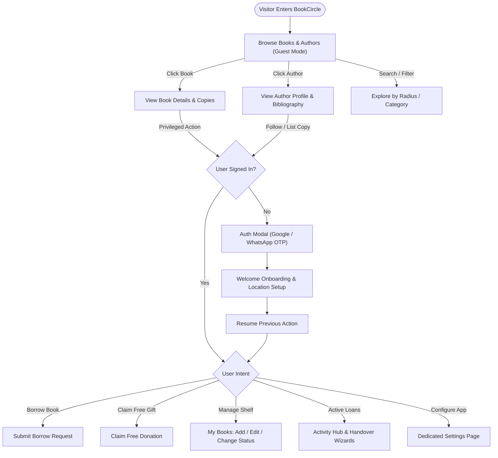
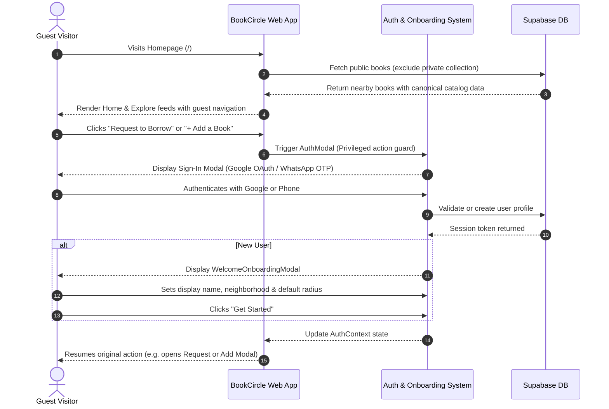
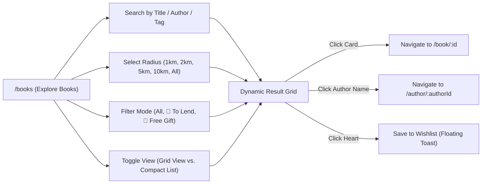
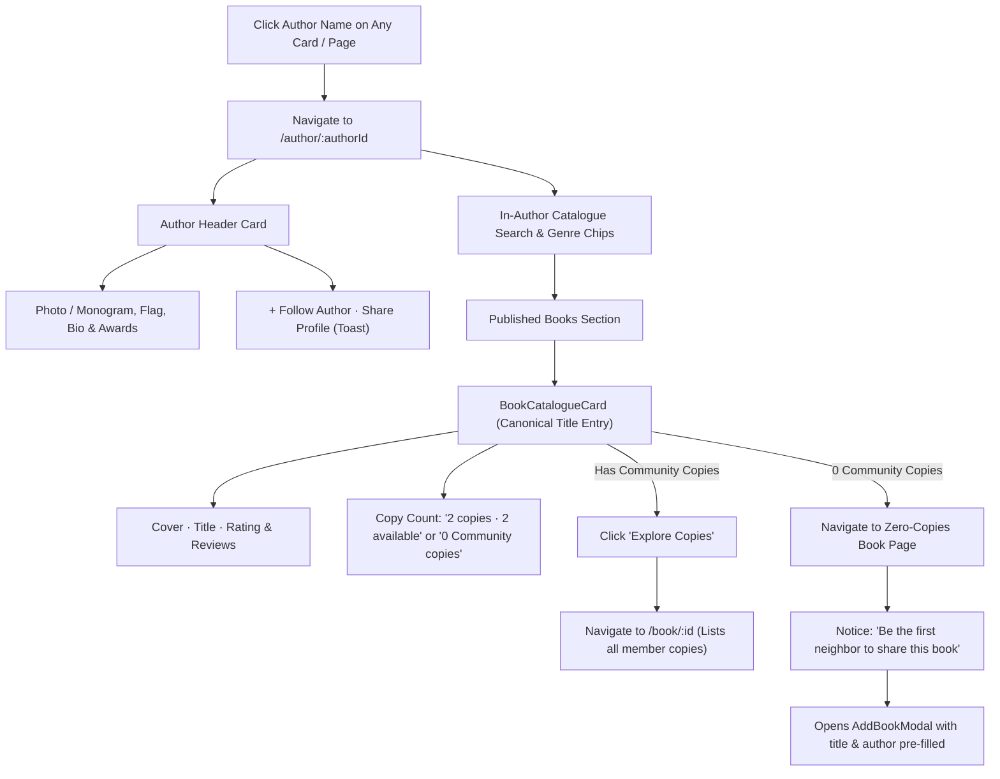
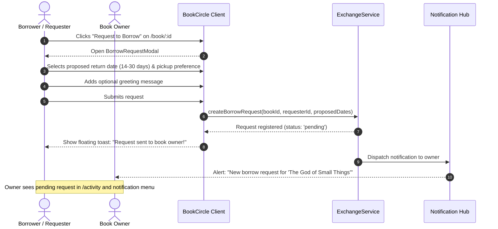
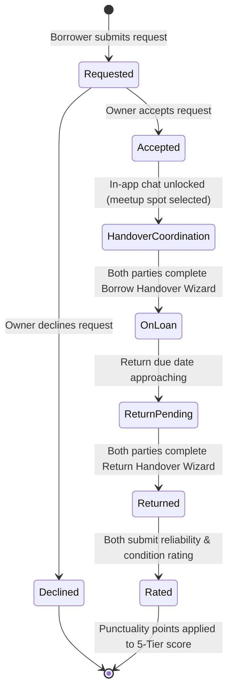
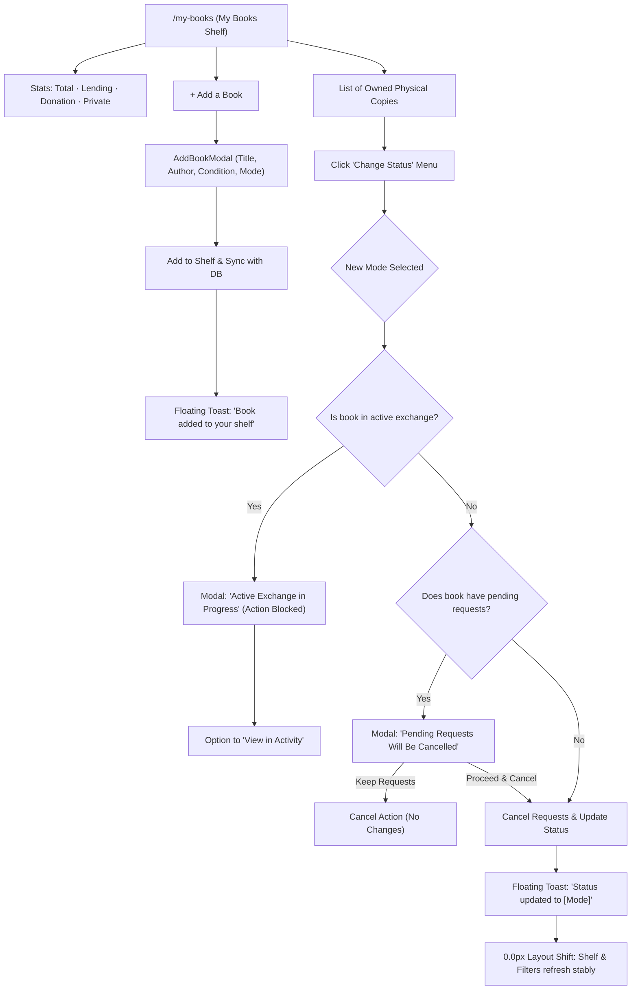
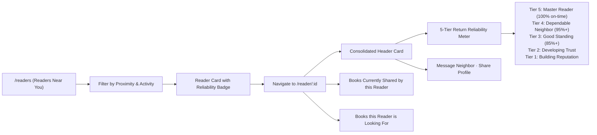
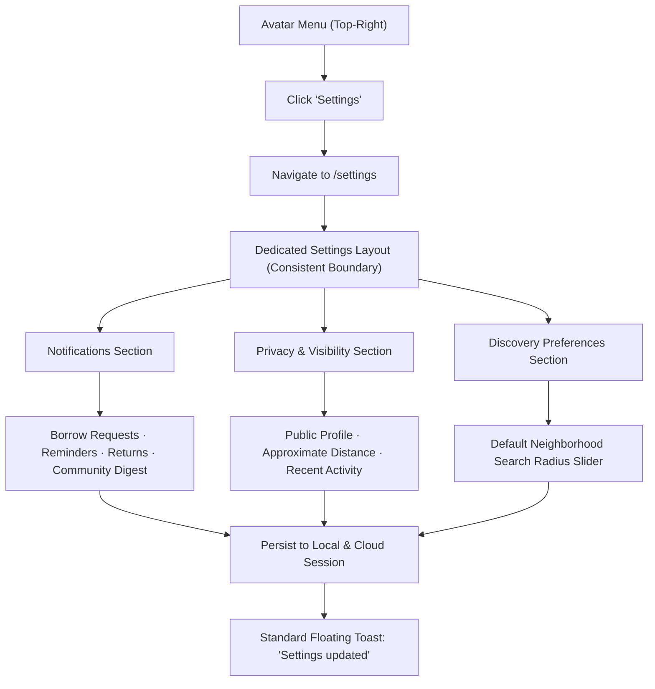

# 🗺️ BookCircle — Comprehensive User Flow Map & Interaction Architecture

This document outlines the complete user journey map, interaction paths, decision logic, and edge-case guards across the **BookCircle** platform. It serves as the primary UX architecture reference for designers, product managers, and frontend engineers.

---

## 📑 Table of Contents

1. [Primary Personas & Roles](#1-primary-personas--roles)
2. [End-to-End User Flow Matrix](#2-end-to-end-user-flow-matrix)
3. [Flow 1: Guest Browsing & First-Time Onboarding](#flow-1-guest-browsing--first-time-onboarding)
4. [Flow 2: Hyperlocal Book Discovery & Search](#flow-2-hyperlocal-book-discovery--search)
5. [Flow 3: Dedicated Author Directory & Bibliography Exploration](#flow-3-dedicated-author-directory--bibliography-exploration)
6. [Flow 4: Borrow Request & Free Gift Claim](#flow-4-borrow-request--free-gift-claim)
7. [Flow 5: Exchange Lifecycle & Handover Wizards](#flow-5-exchange-lifecycle--handover-wizards)
8. [Flow 6: Personal Shelf Management (My Books)](#flow-6-personal-shelf-management-my-books)
9. [Flow 7: Real-Time Chat & Floating FAB Coordination](#flow-7-real-time-chat--floating-fab-coordination)
10. [Flow 8: Reader Profiles & 5-Tier Return Reliability](#flow-8-reader-profiles--5-tier-return-reliability)
11. [Flow 9: Dedicated Settings & Privacy Control](#flow-9-dedicated-settings--privacy-control)
12. [Flow 10: Safety Guards & Edge-Case Workflows](#flow-10-safety-guards--edge-case-workflows)

---

## 1. Primary Personas & Roles

| Persona | Primary Goal | Key Behaviors | Core Friction Points to Avoid |
| :--- | :--- | :--- | :--- |
| **The Curious Neighbor (Guest / New User)** | Discover what books are circulating nearby without high friction. | Browses book titles, explores authors, checks distance radius, reads community reviews. | Paywalls, mandatory registration before browsing, deceptive availability. |
| **The Avid Borrower (Community Reader)** | Borrow books locally, arrange safe meetups, and maintain a high trust score. | Requests books, tracks exchange status, chats with owners, inspects condition, returns on time. | Unresponsive owners, confusing meetup locations, lost deposit/reputation disputes. |
| **The Generous Lender / Donor (Book Owner)** | Share personal library safely, pass on books they love, declutter shelf responsibly. | Lists physical books, sets availability mode (Lend vs. Free Gift), reviews requester reliability, confirms handovers. | Stolen or unreturned books, sudden cancellations, cluttered inventory. |
| **The Literary Explorer (Author Fan)** | Track authors, explore complete bibliographies, discover which neighbors own works by favorite creators. | Clicks author names anywhere, filters published catalogues, follows authors, lists missing titles. | Redundant duplicate cards for identical titles, dead links for authors without accounts. |

---

## 2. End-to-End User Flow Matrix



---

## Flow 1: Guest Browsing & First-Time Onboarding

Allows visitors to explore the real value of the platform immediately before requesting account creation.



- **Entry Point:** Any public route (`/`, `/books`, `/author/:id`, `/readers`).
- **Trigger:** Interacting with an authenticated action (Borrow, Add Book, Chat, Wishlist, Settings).
- **Exit State:** Logged-in session stored in `localStorage` + Supabase session; Welcome guide dismissed; User lands back in original interaction context.

---

## Flow 2: Hyperlocal Book Discovery & Search

Allows readers to find books in their exact physical neighborhood using radius filters, category tags, and layout modes.



### Steps:
1. User lands on `/books` or clicks **Find & Explore Books** from navbar.
2. User adjusts search inputs:
   - **Radius:** Defaults to member's configured setting (e.g., *Within 5 km*).
   - **Mode:** Switches between **All Copies**, **To Lend** (return required), and **Free Gift** (keep forever).
   - **View Mode:** Toggles between 4-column visual cover cards and high-density horizontal list.
3. System groups physical community copies under canonical titles (`catalogId`).
4. User clicks book cover/title to view copies, or clicks author name to view creator profile.

---

## Flow 3: Dedicated Author Directory & Bibliography Exploration

Solves the community duplication problem by clustering copies under unique published catalogue entries.



### Key Decision Branches:
- **Known Bibliography vs. Listed Copies:** An author card displays books published by the author even if no neighbor currently owns a copy.
- **Copy Count Row:** Kept strictly compact on a single horizontal row (`2 copies` left, `2 available` right; or `0 Community copies`).

---

## Flow 4: Borrow Request & Free Gift Claim

Differentiates temporary peer lending from permanent community gifting.



### For Free Community Gifts (Donation Mode):
- The button displays **"Claim Free Gift"** with gift icon.
- No return date selection is required.
- The modal reminds the borrower: *"This book is a gift from your neighbor. You may keep it forever or pass it on to another reader."*

---

## Flow 5: Exchange Lifecycle & Handover Wizards

Structured 6-phase state machine ensuring accountability, physical safety, and verified return punctuality.



### Handover Wizard Steps:
1. **Borrow Handover Wizard:**
   - Step 1: Physical condition inspection (agrees with listed condition).
   - Step 2: Public meetup verification (e.g. *Camden Coffee Roasters*).
   - Step 3: Digital handover sign-off (book marked `On Loan`).
2. **Return Handover Wizard:**
   - Step 1: Return condition confirmation.
   - Step 2: Book returned to owner's shelf.
   - Step 3: Reciprocal rating & trust score increment.

---

## Flow 6: Personal Shelf Management (My Books)

Manages inventory, status updates, and safety checks to prevent orphan loans or cancelled exchanges.



---

## Flow 7: Real-Time Chat & Floating FAB Coordination

Enables contextual communication without page reloads or layout clipping.

```mermaid
flowchart TD
    Trigger["Click 'Message Neighbor' or Open Chat"] --> DeviceCheck{"Viewport Size"}
    
    DeviceCheck -->|Desktop (>= 640px)| DesktopChat["Floating Chat Widget (Fixed Bottom-Right)"]
    DeviceCheck -->|Mobile (< 640px)| MobileSheet["Slide-up Bottom Sheet Modal"]
    
    DesktopChat --> StateFork{"Chat State"}
    
    StateFork -->|Expanded (360x460px)| Expanded["Chat Window Open"]
    Expanded --> MoveFAB["Smart Coordinator: Shifts '+ Add Book' FAB to the left"]
    
    StateFork -->|Minimized (48x280px)| Minimized["Compact Bar with Avatar & Unread Badge"]
    Minimized --> StackFAB["Smart Coordinator: Positions FAB directly above bar"]
    
    StateFork -->|Closed| ClosedState["Chat Dismissed"]
    ClosedState --> ResetFAB["FAB returns to bottom-right corner"]
    
    DesktopChat --> FullscreenTrigger["Click '↗' Expand to Full Page"]
    FullscreenTrigger --> FullMessages["Navigate to /messages (33/67 Split View)"]
```

---

## Flow 8: Reader Profiles & 5-Tier Return Reliability

Transfers trust from subjective star reviews to objective, verified return behavior.



---

## Flow 9: Dedicated Settings & Privacy Control

Manages user preferences on a standalone, responsive page.



---

## Flow 10: Safety Guards & Edge-Case Workflows

Summary of defensive UX mechanisms built into BookCircle to safeguard community trust:

| Edge Case | UX Challenge | Built-in Safety Guard | User Feedback Mechanism |
| :--- | :--- | :--- | :--- |
| **Status Change During Active Loan** | Owner tries to delete or mark a book "Private" while a neighbor is reading it. | Action is strictly intercepted by `isBookInActiveExchange()`. | **LockedModalNotice:** Displays active borrower name, reason, and provides direct link to `/activity`. |
| **Status Change with Pending Requests** | Owner changes availability while neighbors are waiting for approval. | Action checks `hasPendingRequests`. | **PendingCancellationModal:** Informs owner of affected count; requires deliberate confirmation to cancel requests and update status. |
| **Published Book with 0 Copies** | User explores an author's bibliography and finds a title no one has listed yet. | Prevents broken Borrow/Claim buttons. | Displays rich book overview with empty-shelf illustration and **"Add This Book to Community"** pre-filled button. |
| **Unsolicited Direct Messages** | Spammers messaging members without mutual interest. | Chat is gated behind approved borrow requests or mutual book inquiries. | Inactive chat inputs explain that conversation opens once request is accepted. |
| **Layout Shift on Form Feedback** | In-page alert banners pushing content down by 40–80px. | All inline success banners replaced with top floating toasts. | Fixed floating pill at `top-24` with `0.0px` vertical displacement of page content. |
| **Unauthenticated Privileged Clicks** | Guests trying to borrow or add books. | Actions wrapped in authentication check. | Opens Auth Modal, records pending intention, and executes action upon login. |

---

*Document maintained by the BookCircle Product Design & Architecture Team.*  
*Last updated: November 2026.*
